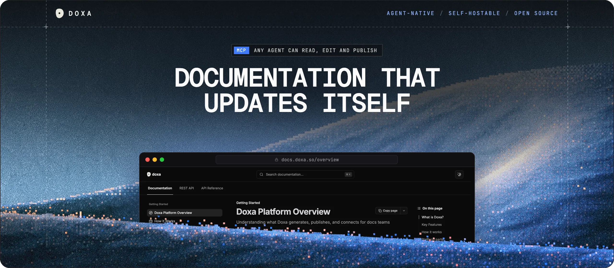

<p align="center">
  <a href="https://doxa.so">
    
  </a>
</p>

<p align="center">
  <b>The agent-native documentation platform.</b><br>
  Doxabot writes your docs from your code and keeps them in sync with every merge.<br>
  Any AI agent can read, edit, preview and publish them through MCP.
</p>

<p align="center">
  <a href="https://doxa.so"><b>Website</b></a> ·
  <a href="https://docs.doxa.so"><b>Docs</b></a> ·
  <a href="https://doxa.so/mcp"><b>MCP server</b></a> ·
  <a href="https://doxa.so/agent"><b>Doxabot</b></a> ·
  <a href="docs/current/self-hosting.md"><b>Self-hosting</b></a> ·
  <a href="https://doxa.so/blog"><b>Blog</b></a>
</p>

<p align="center">
  <a href="LICENSE"></a>
  <a href="https://github.com/Doxahq/doxa/actions/workflows/ci.yml"></a>
  <a href="https://doxa.so/mcp"></a>
</p>

---

## TL;DR

- **What it is:** a documentation platform that writes, hosts and updates the docs for a code repository.
- **What is new:** agents are first-class users. Doxabot writes the docs. Your own agent (Claude Code, Cursor, Codex, VS Code) connects through MCP and edits them on a branch. A person approves before anything goes live.
- **Your content stays yours:** docs are plain MDX files. You can export them at any time.
- **Run it your way:** use the cloud at [doxa.so](https://doxa.so), or self-host the full platform from this repository.
- **Open source:** [Apache 2.0](LICENSE). Use, change, self-host and redistribute Doxa for any purpose.

```sh
# Connect Claude Code to Doxa in one command
claude mcp add --transport http doxa https://mcp.doxa.so/mcp
```

---

## Table of contents

- [Why Doxa](#why-doxa)
- [Get started with an agent](#get-started-with-an-agent)
- [Features](#features)
- [Self-hosting](#self-hosting)
- [Contributing](#contributing)
- [Security](#security)
- [License](#license)

## Why Doxa

Most docs platforms started as editors for people and added AI later: a writing assistant, a chat box, an MCP server for search. Doxa started from the other end. Agents are users from day one: they write the docs, edit them on branches and even sign you up. A person still decides what goes live.

| | Docs platforms with AI added | Doxa |
|---|---|---|
| **First draft** | You write it. AI helps page by page. | Doxabot writes the whole site from your repository. |
| **After a merge** | You find the pages that went stale. | Doxabot reads the diff and rewrites only the pages it affects. |
| **Agent access** | Usually read and search. | Read, write, branch, preview and publish over MCP. OAuth, no API key. |
| **Sign-up** | A person creates the account. | Your agent signs you up. You confirm a code. |
| **Safety** | Built around human editors. | Agents work on branches. Publish, restore and deletes wait for you. |
| **Hosting** | Usually their cloud only. | Our cloud, or self-host it all ([Apache 2.0](LICENSE)). |
| **Your content** | Often vendor-locked. | Plain MDX. Export it any time. |

## Get started with an agent

You have three ways to start. Each one takes a few minutes.

### 1. Let your agent set everything up

Paste this prompt into Claude Code, Cursor, Codex or any agent that can make HTTP requests:

```text
Read https://doxa.so/auth.md and follow it to connect me to Doxa.
```

The agent starts a sign-up, gives you a link and a 6-digit code, and connects to the MCP server after you approve. You never paste a token into the chat.

### 2. Add the MCP server by hand

The server URL is `https://mcp.doxa.so/mcp`. It uses Streamable HTTP and OAuth sign-in.

<details>
<summary><b>Claude Code</b></summary>

```sh
claude mcp add --transport http doxa https://mcp.doxa.so/mcp
```

</details>

<details>
<summary><b>Codex</b></summary>

Add this to `~/.codex/config.toml`, then run `codex mcp login doxa` once:

```toml
[mcp_servers.doxa]
url = "https://mcp.doxa.so/mcp"
```

</details>

<details>
<summary><b>VS Code</b></summary>

Add this to `.vscode/mcp.json`, then click **Start** above the `doxa` entry:

```json
{
  "servers": {
    "doxa": { "type": "http", "url": "https://mcp.doxa.so/mcp" }
  }
}
```

</details>

<details>
<summary><b>Cursor and other clients</b></summary>

```json
{
  "mcpServers": {
    "doxa": {
      "url": "https://mcp.doxa.so/mcp"
    }
  }
}
```

</details>

Then ask your agent, for example: *"Create a Doxa project for this repository and write a quickstart page."* The agent works on an `agent-*` branch, builds a preview, and asks you to approve the publish.

### 3. Use the dashboard

Sign in at [doxa.so](https://doxa.so), connect a GitHub repository, and let Doxabot generate the first version of your docs.

## Self-hosting

Doxa is the same code that runs [doxa.so](https://doxa.so). This repository holds no secrets, no account IDs and no production state. Doxa's own production deploys from a private ops repository, with the same scripts that you can use. The [self-hosting guide](docs/current/self-hosting.md) has every step.

## Contributing

Issues and pull requests are welcome. Read [CONTRIBUTING.md](CONTRIBUTING.md) before you start. It has the repository layout, the setup, the code rules and how to check your change.

## Security

Do not open a public issue for a security problem. Send an email to [security@doxa.so](mailto:security@doxa.so). Read [SECURITY.md](SECURITY.md) for the scope and the rules.

## License

Doxa is open source under the [Apache License 2.0](LICENSE).

<p align="center">
  <sub>Built by <a href="https://doxa.so/about">CoderOne Labs</a>. Copyright © 2026.
</p>
