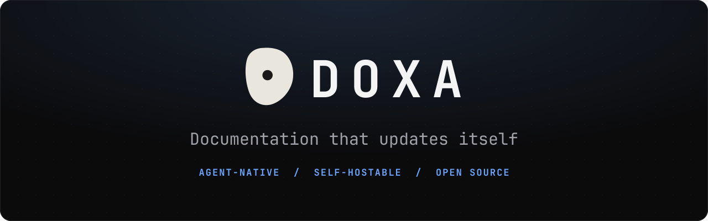

<p align="center">
  <a href="https://doxa.so">
    <picture>
      <source media="(prefers-color-scheme: dark)" srcset=".github/assets/banner-dark.svg">
      <source media="(prefers-color-scheme: light)" srcset=".github/assets/banner-light.svg">
      
    </picture>
  </a>
</p>

<p align="center">
  <b>The agent-native documentation platform.</b><br>
  Doxabot writes your docs from your code and keeps them in sync with every merge.<br>
  Any AI agent can read, edit, preview and publish them through MCP.
</p>

<p align="center">
  <a href="https://doxa.so"><b>Website</b></a> ·
  <a href="https://docs.doxa.so"><b>Docs</b></a> ·
  <a href="https://doxa.so/mcp"><b>MCP server</b></a> ·
  <a href="https://doxa.so/agent"><b>Doxabot</b></a> ·
  <a href="docs/current/self-hosting.md"><b>Self-hosting</b></a> ·
  <a href="https://doxa.so/blog"><b>Blog</b></a>
</p>

<p align="center">
  <a href="LICENSE"></a>
  <a href="https://github.com/Doxahq/doxa/actions/workflows/ci.yml"></a>
  <a href="https://doxa.so/mcp"></a>
  <a href="https://github.com/Doxahq/doxa/stargazers"></a>
</p>

---

## TL;DR

- **What it is:** a documentation platform that writes, hosts and updates the docs for a code repository.
- **What is new:** agents are first-class users. Doxabot writes the docs. Your own agent (Claude Code, Cursor, Codex, VS Code) connects through MCP and edits them on a branch. A person approves before anything goes live.
- **Your content stays yours:** docs are plain MDX files. You can export them at any time.
- **Run it your way:** use the cloud at [doxa.so](https://doxa.so), or self-host the full platform from this repository.
- **Open source:** [Apache 2.0](LICENSE). Use, change, self-host and redistribute Doxa for any purpose.

```sh
# Connect Claude Code to Doxa in one command
claude mcp add --transport http doxa https://mcp.doxa.so/mcp
```

---

## Table of contents

- [Why Doxa](#why-doxa)
- [Get started with an agent](#get-started-with-an-agent)
- [Features](#features)
- [Self-hosting](#self-hosting)
- [Repository layout](#repository-layout)
- [Documentation](#documentation)
- [Contributing](#contributing)
- [Security](#security)
- [License](#license)

## Why Doxa

Most documentation platforms are editors for people. An agent can only reach them through copy and paste, or through a custom script against an API. Doxa is built the other way around: the agent is a user from the first day.

| | A typical docs platform | Doxa |
|---|---|---|
| **First draft** | A person writes every page. | Doxabot reads the repository and writes the first version of the docs. |
| **After a merge** | Someone must remember to update the docs. | Doxabot reads the diff and rewrites only the pages that the change affects. |
| **Agent access** | None, or a REST API that you wire up yourself. | A hosted MCP server with OAuth. No API key to copy. |
| **Agent signup** | A person creates the account. | An agent can create the account. The person confirms with a code in the browser. |
| **Safety** | Edits go live when they are saved. | Agents work on branches. Publish, restore, generate, domain changes and deletes need a person's approval by default. |
| **Review** | A diff of a whole site. | A preview of each branch and a review page by page. |
| **Lock-in** | A proprietary format. | Plain MDX that you can export and take with you. |

## Get started with an agent

You have three ways to start. Each one takes a few minutes.

### 1. Let your agent set everything up

Paste this prompt into Claude Code, Cursor, Codex or any agent that can make HTTP requests:

```text
Read https://doxa.so/auth.md and follow it to connect me to Doxa.
```

The agent starts a sign-up, gives you a link and a 6-digit code, and connects to the MCP server after you approve. You never paste a token into the chat.

### 2. Add the MCP server by hand

The server URL is `https://mcp.doxa.so/mcp`. It uses Streamable HTTP and OAuth sign-in.

<details>
<summary><b>Claude Code</b></summary>

```sh
claude mcp add --transport http doxa https://mcp.doxa.so/mcp
```

</details>

<details>
<summary><b>Codex</b></summary>

Add this to `~/.codex/config.toml`, then run `codex mcp login doxa` once:

```toml
[mcp_servers.doxa]
url = "https://mcp.doxa.so/mcp"
```

</details>

<details>
<summary><b>VS Code</b></summary>

Add this to `.vscode/mcp.json`, then click **Start** above the `doxa` entry:

```json
{
  "servers": {
    "doxa": { "type": "http", "url": "https://mcp.doxa.so/mcp" }
  }
}
```

</details>

<details>
<summary><b>Cursor and other clients</b></summary>

```json
{
  "mcpServers": {
    "doxa": {
      "url": "https://mcp.doxa.so/mcp"
    }
  }
}
```

</details>

Then ask your agent, for example: *"Create a Doxa project for this repository and write a quickstart page."* The agent works on an `agent-*` branch, builds a preview, and asks you to approve the publish.

### 3. Use the dashboard

Sign in at [doxa.so](https://doxa.so), connect a GitHub repository, and let Doxabot generate the first version of your docs.

## Features

**Doxabot, the docs agent**
- Writes the docs for a GitHub repository from its source code.
- Opens a docs preview on each pull request and updates the affected pages after a merge.
- Follows your custom instructions for tone, scope and structure.

**Agent access through MCP**
- Tools for projects, branches, pages, assets, previews, publications, domains and search.
- OAuth sign-in and per-project consent.
- An approval policy: a person approves risky actions in the dashboard.
- Live agent activity in the dashboard, so that you can watch an agent work.

**The docs site**
- Fast, prerendered pages with full-text search and AI chat.
- API reference pages and an API playground.
- Branches, previews and publish history with restore.
- Custom domains, site settings and themes.
- `llms.txt` and `llms-full.txt` for each site, so that other agents can read your docs.

**The editor**
- A visual editor for writers and a source view for MDX.
- Image upload with immutable URLs.

## Self-hosting

Doxa is the same code that runs [doxa.so](https://doxa.so). This repository holds no secrets, no account IDs and no production state. Doxa's own production deploys from a private ops repository, with the same scripts that you can use.

### Run it on your computer

You need Node.js 24, pnpm 10 and Docker.

```sh
git clone https://github.com/Doxahq/doxa.git
cd doxa
pnpm install

cp apps/api/.dev.vars.example apps/api/.dev.vars
cp apps/web/.env.local.example apps/web/.env.local

pnpm db:local:up
pnpm db:local:migrate
pnpm dev
```

`pnpm dev` starts Postgres, the API, the generation workers, the docs renderer, the agent container and the web app. Fill your OAuth and model provider keys in `apps/api/.dev.vars` before you generate real docs. Read [docs/development.md](docs/development.md) for the flags, the local tunnel and the full generation path.

### Run it in production

The production stack runs on Cloudflare (Workers, R2, Queues, Containers, KV and Hyperdrive), a Node API origin on AWS ECS, and Postgres.

1. Create a private ops repository for your Cloudflare IDs, Terraform variables and deploy workflows.
2. Apply the Terraform root module in `infra/terraform/production`.
3. Write the API secrets to AWS SSM.
4. Deploy one commit of this repository with `scripts/deploy-production.mjs`.

Read the [self-hosting guide](docs/current/self-hosting.md) for each step.

## Repository layout

A pnpm monorepo in TypeScript.

| Path | What it does |
|---|---|
| `apps/web` | The `doxa.so` website and the dashboard (TanStack Start). |
| `apps/api` | The API: auth, GitHub, projects, generations and publishing. Runs as a Node origin. |
| `apps/api-edge` | The thin Worker in front of the API origin. |
| `apps/mcp` | The MCP server at `mcp.doxa.so`. |
| `apps/docs-template` | The docs site renderer: MDX, navigation, search and API reference. |
| `apps/docs-runtime` | Serves the published content of each project from R2 to the renderer. |
| `apps/docs-dispatcher`, `apps/docs-prerenderer` | Routing and prerendering for docs sites. |
| `apps/agent-worker`, `apps/agent-container` | The generation queue consumer and the container that checks out repositories and runs Doxabot. |
| `apps/search-gateway` | The search gateway for docs sites. |
| `apps/try-proxy` | The proxy for the API playground. |
| `apps/email-worker`, `apps/utility-jobs` | Email and background jobs. |
| `packages/agent`, `packages/generation` | The Doxabot agent and the generation pipeline. |
| `packages/mdx-runtime`, `packages/docs-prose` | The MDX parser and the shared page renderer. |
| `packages/db` | The Drizzle schema and the migrations. |
| `packages/contracts` | The shared API types and Zod schemas. |
| `infra/terraform` | The production infrastructure on AWS. |

## Documentation

| Topic | Link |
|---|---|
| Product docs | [docs.doxa.so](https://docs.doxa.so) |
| Docs for agents | [docs.doxa.so/llms.txt](https://docs.doxa.so/llms.txt) · [llms-full.txt](https://docs.doxa.so/llms-full.txt) |
| Agent sign-up flow | [doxa.so/auth.md](https://doxa.so/auth.md) |
| MCP server | [doxa.so/mcp](https://doxa.so/mcp) · [docs/current/mcp-server.md](docs/current/mcp-server.md) |
| Local development | [docs/development.md](docs/development.md) |
| Self-hosting | [docs/current/self-hosting.md](docs/current/self-hosting.md) |
| Architecture notes | [docs/current](docs/current) |
| Testing | [docs/testing-strategy.md](docs/testing-strategy.md) |
| GitHub App | [docs/github-app.md](docs/github-app.md) |

> [!TIP]
> **Fun fact:** Doxa writes its own docs. Doxabot generated [docs.doxa.so](https://docs.doxa.so) from this repository, and Doxa hosts it. When we merge a change here, Doxabot updates the affected pages there. Yes, we eat our own dog food. 🐶 This way, every change to Doxa gets a real test on our own docs, and we find what to improve first.

## Contributing

Issues and pull requests are welcome.

1. Open an issue before a large change, so that we can agree on the approach.
2. Read [AGENTS.md](AGENTS.md). It holds the code rules for people and for coding agents.
3. Run `pnpm typecheck` and `pnpm test` before you open a pull request.

## Security

Do not open a public issue for a security problem. Send an email to [security@doxa.so](mailto:security@doxa.so). Read [SECURITY.md](SECURITY.md) for the scope and the rules.

## License

Doxa is open source under the [Apache License 2.0](LICENSE). You can use, change, self-host and redistribute it, also for commercial work.

The license does not give rights to the Doxa name or logo. If you publish a changed copy, give it a different name.

<p align="center">
  <sub>Built by <a href="https://doxa.so/about">CoderOne Labs</a>. Copyright © 2026 CoderOne LLC.</sub>
</p>
