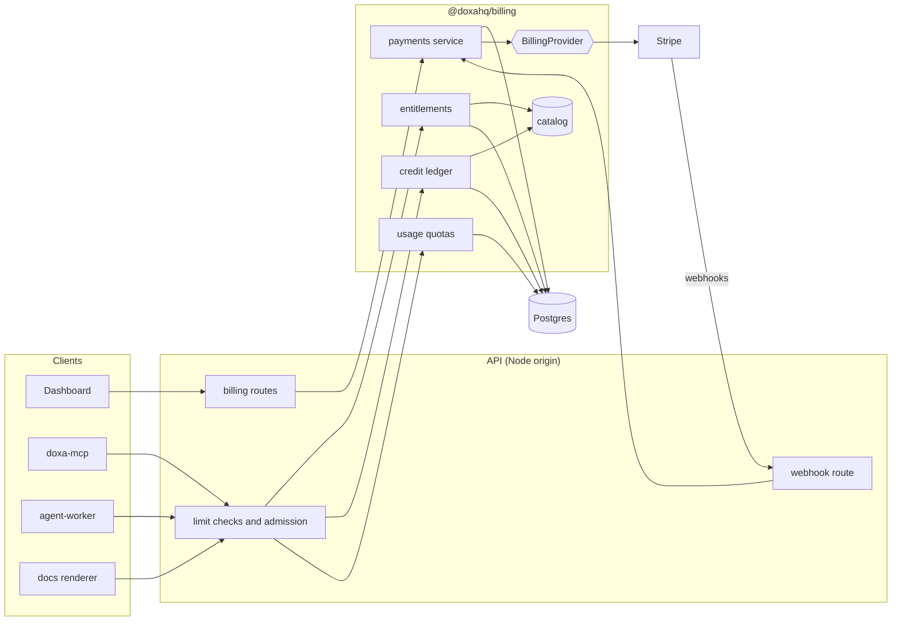
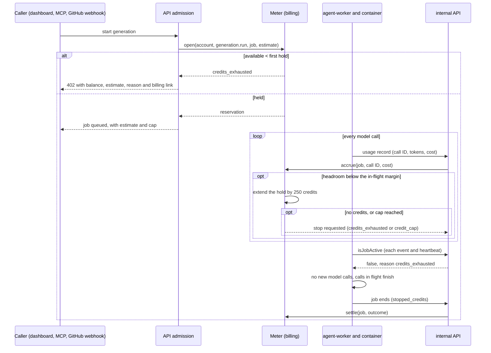

# Billing

Status: **design v3.7, all decisions made, 2026-11-15.** Implementation is in
progress and not committed.
v2 records the user's answers to D1–D10 and replaces the fixed credit price
per action with a base fee plus metered model usage (section 10.5). v2.1 sets
the founder price. v3 replaces credit packs with pay-as-you-go above the
allowance, kept on Managed Payments after a sandbox test (section 10.10,
decisions D2 and D16–D18). v3.1 removes Pay now: charges are automatic only
(decision D19). v3.2 sets the Pro allowance to 5,000 credits a month and
keeps a design for a later Pay now (section 10.11). v3.3 records D11–D15 as
recommended, a trial of 1,000 credits, and a monthly limit from $5 to $200.
No design decision is open. On 2026-11-14 the user confirmed that Free has no
AI and chose unlimited Pro site assets (D20). v3.4 records what the implementation found: the
Customer Portal cannot switch a subscription with a usage price, so the
monthly/yearly switch goes through the API (section 13).

| Version | Date | Change |
|---|---|---|
| v1 | 2026-11-12 | First proposal: fixed credit price per action, founder price $179 / $149 for 100 accounts. |
| v2 | 2026-11-13 | D1–D10 decided. 7-day trial with 2,000 credits. 50 founder spots, then about +30%. Docs chat after launch with a placeholder. Base fee plus metered usage. |
| v2.1 | 2026-11-13 | Founder price $129 / month billed yearly ($1,548 / year), the default, and $159 billed monthly. All prices end in 9. D14 options use the same rule. |
| v3 | 2026-11-13 | No credit packs. Pay-as-you-go above the allowance: on by default for paid accounts, off in the trial, charged at $5 of debt, maximum debt $10, monthly limit $30 by default, a monthly sweep. Stripe meter and billing thresholds on the Managed Payments subscription, tested in the sandbox. |
| v3.1 | 2026-11-13 | No Pay now button (D19). Stripe charges the debt automatically at $5 and in the monthly sweep. The dashboard explains this and lists the charges. |
| v3.2 | 2026-11-13 | Pro allowance 5,000 credits a month (was 10,000, worth $100). A design for a later Pay now with a Checkout Session (section 10.11). D13 recommendation: generation maximum cap 5,000. |
| v3.3 | 2026-11-13 | D11–D15 decided as recommended. Trial credits 1,000 (was 2,000). Pay-as-you-go monthly limit from $5 to $200 (was $1,000), to raise after launch. |
| v3.4 | 2026-11-14 | From the implementation: the Portal does not switch plans (it cannot update a subscription with a usage price), so `POST /billing/accounts/:accountId/plan-interval` does it. Stripe API version `2026-10-28.endive`. Prices have `tax_behavior: exclusive`. Checkout and the founder hold last 31 minutes. |
| v3.5 | 2026-11-14 | Implementation notes after the review (section 24): when billing gates, one open Checkout per account, the hourly sweep that catches up, the `memory` provider only in tests, migrations 0046–0048. |
| v3.7 | 2026-11-15 | A pull request or merge run without a baseline (cold) is a Full generation (D21). The actions are named Full generation (cold) and Update run (warm) in the dashboard. "Start Pro now" ends the trial early (D22). |
| v3.6 | 2026-11-14 | No free first run (D3). Trial and Pro accounts pay every run from their credits. `billing_free_runs`, `credit_reservations.free_run`, `freeFirstRunPerSite` and the 25-page cap are removed. |
| v3.8 | 2026-11-24 | Free plan: 2 branches per site, 20 MB docs storage, 20 MCP tool calls a day. Pro allowance 10,000 credits a month (was 5,000). Storage, branch, site file and custom domain limits answer 403 `plan_limit`. |
| v3.9 | 2026-11-24 | Founder price v2: $99 / month billed yearly ($1,188 / year) and $129 billed monthly (was $129 and $159). New keys `pro_monthly_founder_v2` and `pro_yearly_founder_v2`. The v1 founder keys stay for their customers, closed to new Checkouts. `founder_v1` keeps its 50 slots and names the v2 prices. The founder lines say "locked in forever". The standard prices do not change. |
| v3.10 | 2026-11-25 | Free plan: 10 MCP tool calls a day (was 20). The pricing page reads the number from the catalog. |

When a part ships, describe the built state in `docs/current/billing.md` and
keep this file as the design record. Research and sources:
[research.md](research.md).

## 1. Summary

Doxa sells three plans (Free, Pro, Enterprise) and AI credits. One package,
`@doxahq/billing`, owns every billing rule. Stripe is the first payment
provider. Doxa keeps plans, entitlements, credits and usage in its own
Postgres database. The provider only moves money: customers, Checkout,
subscriptions, invoices, tax and refunds.

Four rules shape the design:

1. **Gate on local state.** No request waits on the provider to decide what an
   account can do. Webhooks and a sync job copy provider state into Postgres.
2. **One place to change prices and limits.** The catalog file
   `packages/billing/src/catalog/doxa.ts` holds every plan, price, offer,
   limit, base fee and the usage markup. A sync command makes the provider
   match it.
3. **Every credit change is a ledger entry with an idempotency key.** A retry
   or a webhook replay never charges or grants twice.
4. **Feature code never imports a provider.** It asks the billing package
   questions (`can this account do X`, `reserve N credits`). Only the billing
   package knows that Stripe exists.

We do not use Autumn or another billing layer. Section 22 and
[research.md](research.md) give the reasons.

## 2. Goals and non-goals

Goals:

- Self-serve Pro: Checkout, monthly and yearly prices, plan switch, cancel,
  payment-method update, invoice list and invoice payment.
- AI credits: a monthly allowance, pay-as-you-go above the allowance, and a
  charge per AI action of a base fee plus the metered model usage with our
  markup. The meter runs in real time, with an estimate before the run, a cap
  for each run, a live meter in the dashboard, and a pause of AI features at
  the maximum debt or the monthly limit (section 10.10).
- A founder price for the first 50 customers that closes by itself.
- Plan limits enforced in the API, the MCP server, generation and docs hosting.
- Personal and team billing accounts.
- A provider swap without changes in feature code.
- Self-hosted installs that run without a payment provider.
- Deterministic tests for every rule, plus opt-in tests against a Stripe
  sandbox.

Non-goals for v1:

- A Pay now button. Charges are automatic only (decision D19). Section 10.11
  keeps a design for later.
- Credit packs (decision D18).
- Prices in currencies other than USD.
- Per-seat prices. Pro has unlimited seats.
- Stripe billing credits and Stripe token billing. Doxa keeps its own credit
  ledger. A Stripe meter only carries the pay-as-you-go debt (section 10.10).
- A card form of our own. Stripe Checkout and the Customer Portal collect all
  card data.

## 3. Prices and limits that are decided

Source: the pricing page (`apps/web/src/lib/marketing/pricing.ts`) and the
pricing decisions of 2026-10-29 and 2026-10-30.

| | Free | Pro | Enterprise |
|---|---|---|---|
| Price | $0 | Founder price: $99 / month billed yearly ($1,188 / year), or $129 / month billed monthly. Yearly is the default on the pricing page. Yearly saves $360 (23%, more than 2 months). The founder price is locked in forever while the subscription stays active. | Custom, sales-led |
| Founder offer | | The founder price is for the first 50 paying accounts (section 7.5) | |
| Price after the founder offer | | $169 / month billed yearly ($2,028 / year), or $209 / month billed monthly. 71% more than the yearly founder price, and 62% more than the monthly founder price. Decision D14. | |
| Trial | | 7 days, card required, 1,000 trial credits | |
| AI credits per month | 0 | 10,000 (worth $100) | 50,000+ (per contract) |
| Pay-as-you-go above the allowance | No | $0.01 for each credit. On by default for paid accounts, off during the trial. A charge each time the debt reaches $5, maximum debt $10, monthly limit $30 that the user can change (section 10.10). | Per contract |
| Doxa Agent (generation from a repo) | No | Yes | Yes |
| Doxabot (pull request and merge runs) | No | Yes | Yes |
| Approval before publish | No | Yes | Yes |
| AI chat on the docs site | No | After launch (section 10.9) | After launch |
| Branches per site | 2 | Unlimited | Unlimited |
| Docs storage | 20 MB | Unlimited | Unlimited |
| Site assets (images and files) | 50 MB, 200 files | Unlimited (D20) | Unlimited |
| Custom domains | 1 | 4 | Unlimited |
| Remove "Powered by Doxa" | No | Yes | Yes |
| Hosting | Shared | Dedicated | Dedicated + custom support |
| MCP tool calls | 20 / day | Unlimited | Unlimited |
| Team seats | Owner only | Unlimited | Unlimited |
| Role-based permissions | No | Yes | Yes |
| Approval rules for agents and MCP clients | No | No | Yes |

Credit price of an AI action (1 credit = $0.01), from section 10.5:

```txt
credits = base fee + ceil(model cost in USD × markup × 100)
```

| Action | Base fee | Usage | Cap for one run | Notes |
|---|---|---|---|---|
| Full generation (`generation.run`): every generation a person starts (warm or cold), and a pull request or merge run without a baseline, which is cold (D21). | 50 | Model cost × 3 | 3,000 | |
| Update run (`doxabot.run`): warm, builds on a baseline. A pull request preview or a merge run that has a baseline. | 20 | Model cost × 3 | 500 | A run that changes nothing pays the usage only (decision D12). |
| Docs chat answer | Not set | Not set | Not set | Planned. Section 10.9 keeps a place for it. |
| MCP tool call, hosting, previews | 0 | 0 | | Never charged |

The base fees, the markup 3 and the caps are decided (D11 and D13). Phase 5
can tune them after 2 weeks in shadow mode. With the model costs measured on
2026-10-25, the formula gives:

| Run | Model cost | Credits |
|---|---|---|
| Generation, 50 pages | $0.72–1.00 | 50 + 216–300 = 266–350 |
| Doxabot pull request run | $0.34–0.80 | 20 + 102–240 = 122–260 |

The Pro allowance of 10,000 credits (5,000 until 2026-11-24) is then 28–37
generations of 50 pages, or 38–81 Doxabot runs. At markup 3, an account that
uses all 10,000 credits costs Doxa at most about $33 in model fees. With the old fixed price (100 credits), a Doxabot run cost
Doxa up to $0.80 for $1.00 of credits.

Other rules: a failed action costs 0. Monthly credits expire at the end of the
month. Above the allowance, a paid account continues with pay-as-you-go. AI
features pause only at the maximum debt, at the monthly limit, after a failed
charge, or when trial credits run out. Hosting never pauses. v1 sells no credit
packs (decision D18).

## 4. Blockers and prerequisites

Billing can start now. The code already sends every limit check through
injected services with free-plan stubs (`EntitlementsService`,
`StorageLimitsService`, `SearchPolicyService`, `DocsDomainLimitPolicy`). Billing
replaces those stubs. The items below must be decided or built first, or in the
same project.

### 4.1 Checks before the first customer

The user decided D1–D19 on 2026-11-13 (section 21.1). No design decision is
open. One check remains before the first customer:

| ID | Decision | Why it blocks |
|---|---|---|
| D2 | Check Managed Payments with an accountant. Test the open items of the sandbox test (section 10.10): tax on usage invoices, a failed payment, the monthly/yearly switch through `plan-interval`, the final invoice at cancel. | Managed Payments works only for subscriptions that start in a Managed Payments Checkout Session. Existing subscriptions cannot move to it later, so the check comes before the first customer. |

### 4.2 Gaps in the code

| Gap | Where | What billing needs |
|---|---|---|
| The pricing page shows old Pro prices | `PLANS` in `apps/web/src/lib/marketing/pricing.ts`: $179 monthly, $149 yearly ($1,788), "first 100 customers", toggle note "−17%". Also "10,000 AI credits / month", the old fixed credit prices ("100 credits plus 5 per page") and "Packs (pay-as-you-go coming soon)" | The page reads the founder prices from the catalog: $129 yearly (the default, already `DEFAULT_BILLING`) and $159 monthly, "−19%", "N of 50 founder spots left". It shows 5,000 credits, the metered price (base fee plus usage), and pay-as-you-go at $0.01 for each credit. |
| Free branch limit is 10, the pricing page says 2 | `FREE_PLAN_ENTITLEMENTS` in `packages/contracts/src/entitlements.ts` | The plan sets the value. |
| Every site gets Typesense search | `DOXA_PROD_SEARCH_PAID_PROJECT_IDS=*` read by `apps/api/src/services/docs-search/policy.ts` | The plan sets the policy. Free sites go back to MiniSearch, which needs a re-index. |
| Custom domain limit is a constant 1 | `apps/api/src/services/docs-domain-limit-policy.ts` | The plan sets the limit. |
| Storage limits are always the Free values | `apps/api/src/services/free-plan-entitlements.ts` | The plan sets the limits. |
| Dedicated hosting is an operator list | `DOXA_PROD_SHARED_ISOLATE_SITE_IDS` in `apps/docs-dispatcher/src/renderer-isolate.ts` | The host resolution carries the hosting tier of the site's plan (section 9.4). |
| The hosted renderer has no docs chat | `apps/docs-template/src/lib/chat-availability.ts` turns chat off in the platform build | Billing launches without chat (decision D10). Section 10.9 defines the place where chat connects later. Hide the chat line on the pricing page. |
| No daily MCP quota | `apps/mcp/src/rate-limit.ts` has only per-minute abuse limits | A daily counter per billing account (section 11). |
| Anyone can create a team and invite members | `POST /teams`, `POST /teams/:teamId/invites` | The `team.seats` limit, and a `billing.manage` capability in `ROLE_CAPABILITIES` (`packages/contracts/src/teams.ts`). |
| Generation admission and job end have no credit step | `JobsRepository.create`, `admitDoxabotJob`, `admitPreviewRerun`; `markJobFailed`, `markJobCancelled`, `completeJobOutput`, `publishJobOutput` in `apps/api/src/services/internal-api.ts` | Open the meter at admission, settle at the end (section 10.5). |
| Usage records do not reach billing | The worker sends one usage record for each model call (`onUsage` in `apps/agent-worker/src/generation-workflow-runtime.ts`). The internal API stores it (`recordUsage`, `apps/api/src/services/internal-api.ts`). | After the insert, the internal API calls `meter.accrue` (section 10.5). |
| The worker has no "stopped for credits" result | `ensureJobActive` throws "Generation job is no longer active", and `usageFailureStatus` maps it to `cancelled` | `isJobActive` returns a stop reason. The job ends as `stopped_credits` and keeps its finished pages. |
| A model without a price has a null cost | `anthropicModelPrice` in `packages/agent/src/core/providers/anthropic-pricing.ts` returns `undefined` for an unknown model | Admission refuses a run whose planner, writer or fallback model has no price. |
| Webhook path rules | `CSRF_EXEMPT_PATHS` in `apps/api/src/http/csrf.ts`, `UNCOUNTED_PATHS` in `apps/api-edge/src/rate-limit.ts` | Add `/billing/webhooks/stripe` to both. The edge already forwards the raw body. |
| User deletion cascades | `projects.user_id` has `onDelete: cascade` | Billing records must outlive a user for tax and dispute records (section 16.3). |

### 4.3 Operations, legal and Stripe account

- **The nightly ECS pause must end before the first charge.** The API stops
  from 01:00 to 10:00 Algiers time. Stripe retries webhooks for up to 3 days,
  so no event is lost, but paying customers lose the dashboard for 9 hours.
- **Signups are closed** (`AUTH_SIGNUPS_ENABLED`). Reopen them with the billing
  launch.
- **Privacy policy:** it says "Doxa does not take payments today". Name Stripe
  as a subprocessor. With Managed Payments, also name Stripe as the merchant of
  record.
- **Terms:** add the credit rules (monthly expiry, no cash value, how a
  metered action is priced, the cap for one run), the pay-as-you-go rules
  (postpaid usage at $0.01 for each credit, a charge each time the debt reaches
  $5 and once a month, the maximum debt, the monthly limit), the 7-day
  trial rules, the founder price rules (section 7.5), and the auto-renewal
  disclosure. CoderOne LLC is
  in California, and the California auto-renewal law requires clear renewal
  terms, consent and an online cancel. The Customer Portal gives the online
  cancel. The Terms already promise 30 days of notice before a price change.
- **Stripe account:** business verification, payouts, statement descriptor,
  branding, Customer Portal settings, Radar rules, customer emails (receipts,
  failed payments, trial ending), one sandbox for development and one for
  staging, a webhook endpoint for each environment, and a restricted API key.
- **Secrets:** `STRIPE_SECRET_KEY` and `STRIPE_WEBHOOK_SECRET` go to SSM through
  `doxa-ops` (`pnpm secrets:api:ecs`). They are secrets, so they never go in
  this public repo or in a Wrangler file.

## 5. Architecture



| Concern | Owner | Notes |
|---|---|---|
| Plans, prices, limits, credit costs | Catalog in `@doxahq/billing` | Typed code. The provider gets a copy through the sync command. |
| What an account can do now | Doxa Postgres | Computed from the mirrored subscription and overrides. |
| Credit balances and history | Doxa Postgres | Append-only ledger. |
| Daily quotas (MCP) | Doxa Postgres | One counter row per account, meter and day. |
| Customers, payment methods, subscriptions, invoices, tax, refunds | Provider | Mirrored into Postgres by webhooks and the sync job. |
| Card data | Provider | Never touches Doxa servers (Checkout and Portal are hosted pages). |

## 6. The package `@doxahq/billing`

### 6.1 Layout

```txt
packages/billing/
  AGENTS.md                  # how to change pricing safely (section 7.4)
  src/
    catalog/
      define.ts              # defineCatalog() and its checks
      doxa.ts                # THE Doxa catalog: plans, prices, usage prices, offers, pay-as-you-go, base fees, markup, caps
      keys.ts                # feature, limit, price and action keys as unions
    entitlements/
      resolve.ts             # pure: plan + status + overrides -> Entitlements
      adapters.ts            # Entitlements -> the existing API interfaces
    credits/
      allowance.ts           # pure: monthly windows from a billing anchor
      pricing.ts             # pure: base fee + model cost x markup, charge rules, cap
      meter.ts               # CreditMeter: open, accrue, extend, stop, settle (section 10.5)
      estimate.ts            # pure: estimate range from past runs
      ledger.ts              # CreditLedger: grant, reserve, extend, settle, release, revoke, debt
      payg.ts                # pure: debt room, monthly limit, threshold and sweep amounts (section 10.10)
    offers/
      founder.ts             # OfferSlots: hold, claim, release, slots left (section 7.5)
    quotas/
      daily-quota.ts         # UsageQuota: consume and read a daily counter
    accounts/
      resolve-account.ts     # project -> billing account
    payments/
      service.ts             # BillingPayments: checkout, portal, invoices, sync
      webhooks.ts            # verify, store, dispatch provider events
    provider/
      provider.ts            # BillingProvider interface and normalized types
      errors.ts
    providers/
      stripe/                # the Stripe provider (Node only)
      none/                  # self-hosted installs: no payments
      memory/                # tests: deterministic fake with a fake clock
    store/
      store.ts               # BillingStore interface
      postgres.ts            # Drizzle implementation over @doxahq/db
      memory.ts              # in-memory implementation for unit tests
    config.ts                # BillingEnv, readBillingConfig()
    provider-registry.ts     # BILLING_PROVIDERS, createBillingProvider()
    testing.ts               # fixtures, fake clock, provider contract suite
  tests/
```

The layout follows `packages/email`: a provider-neutral core, a registry of
providers, and a `testing` export.

### 6.2 Exports and import rules

| Export | Contents | Who imports it |
|---|---|---|
| `@doxahq/billing/catalog` | Catalog, keys, price display helpers. Depends only on `zod`. | Web (pricing page, billing page), API, MCP, docs runtime |
| `@doxahq/billing` | Types, entitlements, credit ledger, quotas, account resolution, Postgres store. No provider SDK. | API, MCP, agent-worker |
| `@doxahq/billing/payments` | Payments service, webhooks, provider registry. | API Node origin only |
| `@doxahq/billing/stripe` | Stripe provider. Imports the `stripe` SDK. | API Node origin only, through the registry |
| `@doxahq/billing/testing` | Memory store, memory provider, fake clock, contract suite, fixtures. | Tests only |

Rules, each checked by a test:

- Code outside `packages/billing` never imports `stripe`.
- `apps/web` imports only `@doxahq/billing/catalog`.
- `apps/mcp` and the Workers never import `@doxahq/billing/payments` or
  `@doxahq/billing/stripe`. They only read entitlements and use the ledger.
- Keep Node-only code out of the Worker builds (`AGENTS.md` rule for
  `apps/api/src/runtime/node`).

### 6.3 Configuration

`BillingEnv`, read once at startup by `readBillingConfig()`. A wrong value fails
startup with `BillingConfigurationError`, never a request.

| Setting | Values | Default | Use |
|---|---|---|---|
| `BILLING_PROVIDER` | `stripe`, `none`, `memory` | `none` | Picks the provider in `BILLING_PROVIDERS`. |
| `BILLING_ENFORCEMENT` | `off`, `shadow`, `on` | `off` | `shadow` logs each denial and allows the action. `on` denies. |
| `BILLING_DEFAULT_PLAN` | A plan key | `free` with a provider, `self_hosted` with `none` | Plan of an account without a subscription. |
| `STRIPE_SECRET_KEY` | A restricted key | | Stripe provider only. |
| `STRIPE_WEBHOOK_SECRET` | `whsec_...` | | Stripe provider only. |
| `STRIPE_MANAGED_PAYMENTS` | `on`, `off` | `off` | Sets `managed_payments[enabled]` on Checkout Sessions (decision D2). |
| `BILLING_RETURN_BASE_URL` | URL | The dashboard URL | Base of Checkout and Portal return URLs. |

The Stripe API version is a constant in `providers/stripe/client.ts`, not a
setting. A version change is a code change with tests.

To switch providers, write `providers/<name>/`, add its settings to
`BillingEnv`, add one entry to `BILLING_PROVIDERS`, and change
`BILLING_PROVIDER`. Feature code does not change.

## 7. The catalog

### 7.1 Shape

The catalog is TypeScript data, checked by `defineCatalog()` at import time and
by tests. An agent changes pricing by editing this one file.

```ts
export const DOXA_CATALOG = defineCatalog({
  version: 1,
  currency: "usd",
  credit: { unitPriceCents: 1 },

  plans: {
    free: {
      name: "Free",
      selfServe: true,
      hosting: "shared",
      features: {
        "ai.doxa_agent": false, "ai.doxabot": false, "ai.docs_chat": false,
        "ai.payg": false, "docs.publish_approvals": false,
        "site.remove_powered_by": false, "site.typesense_search": false,
        "team.role_permissions": false, "agents.approval_rules": false,
      },
      limits: {
        "ai.credits_monthly": 0,
        "docs.branches_per_site": 2,
        "docs.storage_bytes": 20 * MB,
        "site.asset_bytes": 50 * MB,
        "site.asset_files": 200,
        "site.custom_domains": 1,
        "team.seats": 1,
        "mcp.tool_calls_per_day": 10,
        "docs.export_window_hours": 24,
      },
    },
    pro: {
      name: "Pro",
      selfServe: true,
      hosting: "dedicated",
      features: { /* every feature true except agents.approval_rules */ },
      limits: {
        "ai.credits_monthly": 10_000,
        "docs.branches_per_site": UNLIMITED,
        "site.custom_domains": 4,
        "team.seats": UNLIMITED,
        "mcp.tool_calls_per_day": UNLIMITED,
        "docs.export_window_hours": 1,
        "docs.storage_bytes": UNLIMITED,
        "site.asset_bytes": UNLIMITED, // decision D20
        "site.asset_files": UNLIMITED,
      },
      trial: { days: 7, credits: 1_000, requiresPaymentMethod: true }, // decision D3
    },
    enterprise: { name: "Enterprise", selfServe: false, /* ... */ },
    self_hosted: { name: "Self-hosted", selfServe: false, /* all on, credits not enforced */ },
  },

  // `usage` names the usage price that goes into the same Checkout. It has the
  // same interval, because Checkout refuses mixed intervals (section 10.10).
  prices: {
    // Founder v1 ($159 / $129 x 12): replaced by v2 on 2026-11-24, before launch.
    pro_monthly_founder_v1: { plan: "pro", interval: "month", amountCents: 15_900, usage: "ai_usage_monthly_v1", availableForNewCustomers: false },
    pro_yearly_founder_v1: { plan: "pro", interval: "year", amountCents: 154_800, usage: "ai_usage_yearly_v1", availableForNewCustomers: false },
    pro_monthly_founder_v2: { plan: "pro", interval: "month", amountCents: 12_900, usage: "ai_usage_monthly_v1" },
    pro_yearly_founder_v2: { plan: "pro", interval: "year", amountCents: 118_800, usage: "ai_usage_yearly_v1" }, // $99 x 12
    pro_monthly_v1: { plan: "pro", interval: "month", amountCents: 20_900, usage: "ai_usage_monthly_v1" }, // decision D14
    pro_yearly_v1: { plan: "pro", interval: "year", amountCents: 202_800, usage: "ai_usage_yearly_v1" }, // $169 x 12
  },

  // Metered prices on the Stripe meter `doxa_ai_overage`, $0.01 for each credit.
  usagePrices: {
    ai_usage_monthly_v1: { interval: "month", unitAmountCents: 1, meter: "doxa_ai_overage" },
    ai_usage_yearly_v1: { interval: "year", unitAmountCents: 1, meter: "doxa_ai_overage" },
  },

  // Section 7.5. When the founder offer is full, new Checkouts use `then`.
  offers: {
    founder_v1: {
      label: "Founder price",
      maxAccounts: 50,
      prices: { month: "pro_monthly_founder_v2", year: "pro_yearly_founder_v2" },
      then: { month: "pro_monthly_v1", year: "pro_yearly_v1" },
    },
  },

  // Section 10.10. Decisions D16, D17 and D18 (no credit packs in v1).
  payg: {
    defaultOn: true,                  // for paid accounts
    duringTrial: false,
    chargeAtCredits: 500,             // $5: the Stripe billing threshold
    maxDebtCredits: 1_000,            // $10: runs stop here
    defaultMonthlyLimitCents: 3_000,  // $30: the user can change it
    monthlyLimitRangeCents: [500, 20_000], // $5–$200 at launch, raise later
    sweepMinCredits: 50,              // $0.50: the Stripe threshold minimum
  },

  // Section 10.5. One markup for every model. Decision D11.
  usage: { markup: 3, extendStepCredits: 250 },

  actions: {
    "generation.run": {
      status: "live",
      pricing: {
        kind: "metered",
        base: 50, // decision D11
        minCap: 1_000, // since 2026-11-16
        defaultCap: 3_000, maxCap: 10_000, // decision D13; 10,000 since 2026-11-15
        inFlightMarginCredits: 300,
        defaultEstimateCredits: 400,
        charge: { succeeded: "base+usage", stopped: "base+usage", cancelled: "base+usage", failed: "none" },
      },
    },
    "doxabot.run": {
      status: "live",
      pricing: {
        kind: "metered",
        base: 20,
        minCap: 500, // since 2026-11-16
        defaultCap: 500, maxCap: 10_000, // 10,000 since 2026-11-15
        inFlightMarginCredits: 100,
        defaultEstimateCredits: 200,
        charge: {
          pages_changed: "base+usage", no_change: "usage", // decision D12
          superseded: "usage", stopped: "base+usage", cancelled: "base+usage", failed: "none",
        },
      },
    },
    // Section 10.9. Planned: the pricing page hides it and entitlements deny it.
    "docs_chat.answer": {
      status: "planned",
      pricing: { kind: "unset", charge: { answered: "base+usage", no_answer: "none", failed: "none" } },
      perSiteDailyCapCredits: null, // must be set before the status is "live"
    },
    "mcp.tool_call": { status: "live", pricing: { kind: "free" } },
  },

  safety: {
    maxDailyModelCostUsdPerAccount: 75, // internal stop, see section 19
  },

  teams: { freeTeamsPerOwner: 1 }, // section 8.1
});
```

`pricing.kind` is one of `metered` (base fee plus usage), `flat` (a fixed
number of credits), `free` or `unset`. Only a `planned` action can be `unset`.
The meter in section 10.5 handles `metered` and `flat` with one code path: a
flat action is a metered action with a markup of 0 and a base fee equal to its
price.

Notes:

- `UNLIMITED` is a branded constant, never `Infinity`, so it survives JSON.
  Adapters map it to the value each old contract accepts (for example
  `maxBranchesPerSite` has a schema maximum of 1000).
- Every plan must list every feature and limit key. A missing key fails the
  type check and `defineCatalog()`.
- The pricing page reads its numbers (prices, credits, caps) from the catalog,
  so the page and the code never disagree. The copy stays in
  `apps/web/src/lib/marketing/pricing.ts`.

### 7.2 Keys and versions

- A price key ends with a version: `pro_monthly_founder_v1`. A price amount
  never changes. To change a price, add `pro_monthly_v2` and set the old key to
  `availableForNewCustomers: false`. Customers on `v1` stay on `v1`
  (grandfathering, decision D4).
- The provider object for a price uses the catalog key as its lookup key
  (Stripe `lookup_key`). The repo stores no provider IDs. This matches the
  `AGENTS.md` rule against account-issued IDs in this public repo.
- `catalog.lock.json` is a committed snapshot of every price key and amount. A
  test fails when an existing key changes its amount, interval or credits, with
  the message: "Prices are immutable. Add a new price version."
- The lock also stores the markup, the base fees, and a hash of the model price
  table (`packages/agent/src/core/providers/anthropic-pricing.ts`). The meter
  charges model cost × markup, so a change to that table changes what
  customers pay. A change to any of these fails the lock test until the same
  pull request updates the lock. This makes each such change a visible pricing
  change.
- Base fees, the markup and caps can change without a new key. Each settle
  entry stores the values it used, so the history stays correct.

### 7.3 Sync to the provider

`pnpm billing:catalog:sync` (in `scripts/`) reads the catalog and the provider,
then prints a plan:

```txt
create product  doxa_pro            "Doxa Pro"
create price    pro_monthly_founder_v1  $159.00 / month
keep   price    credits_5k_v1       $50.00 one time
archive price   pro_monthly_v0      (no catalog entry, 0 active subscriptions)
```

- The default is a dry run. `--apply` makes the changes, with idempotency keys.
- The command never deletes a price and never archives a price that has
  active subscriptions.
- It sets each product's tax code (needed for Stripe Tax and Managed Payments).
- It writes the two Customer Portal configurations. Plan updates are off in
  both (section 13).
- It creates each price with `tax_behavior: exclusive`: tax goes on top of the
  price.
- Run it against a sandbox first. A live run asks for `--live` and prints the
  account name.

### 7.4 Rules for an agent that changes pricing

`packages/billing/AGENTS.md` holds these rules:

1. Change only `src/catalog/doxa.ts` for a price, offer, limit,
   pay-as-you-go setting, base fee, markup or cap.
2. Never change the amount of an existing price key. Add a new version.
3. Run `pnpm --filter @doxahq/billing test`. The catalog tests and the lock
   test must pass. Update `catalog.lock.json` only for a new key, or for a
   change to the markup, a base fee or the model price table. Say in the pull
   request which customer charges change.
4. Run `pnpm billing:catalog:sync` against the sandbox and paste the plan in
   the pull request.
5. Ask the user before a live sync.
6. A new feature or limit key needs an enforcement point and a test in the
   same change. Section 9.3 lists the enforcement points.
7. To change the founder offer after launch, add `founder_v2`. Never lower
   `maxAccounts` of a live offer below its claimed count.

### 7.5 Founder offer (decisions D4 and D15)

The first 50 paying billing accounts get the founder price. After that, the
pricing page and Checkout show the price in `then`. No deploy is needed for
the switch.

A slot has one of three states, in the table `billing_offer_slots`:

| State | When | Counts toward 50 |
|---|---|---|
| `held` | Checkout for a founder price starts. The hold ends with the Checkout Session (`expires_at` = 31 minutes: Stripe needs at least 30 by its own clock). If the customer starts a trial, the hold lasts until the trial ends. | Yes |
| `claimed` | The first paid invoice with an amount above 0 (`invoice.paid`) | Yes, for all time |
| `released` | The Checkout Session expires (`checkout.session.expired`), or the trial ends without a payment | No |

Rules:

1. One slot for each billing account. A team account and a personal account
   are two accounts.
2. Checkout creation locks the offer row (`SELECT ... FOR UPDATE`) and counts
   `held` plus `claimed`. Two customers who try to take the 50th slot at the
   same time run one after the other. One gets the slot. The other gets
   `409 offer_closed` with the new price, and the dashboard asks the customer
   to accept the new price before Checkout opens. Doxa never charges a price
   that the customer did not see.
3. A claimed slot never opens again. The offer means "the first 50 paying
   customers".
4. A founder keeps the founder price while the subscription stays active,
   also through a switch between monthly and yearly. A founder who cancels
   and subscribes again later pays the price of that day. The Terms say this.
5. A founder who switches between monthly and yearly stays on the founder
   price of the other interval. The switch goes through
   `POST /billing/accounts/:accountId/plan-interval` (section 13). The Customer
   Portal still has two configurations (founder and standard), picked from the
   account's price key, but plan updates are off in both.
6. `GET /billing/offers` (public, cached 60 seconds) returns the current Pro
   prices, `founder.open` and `founder.slotsLeft`. The pricing page reads it.
   It shows "N of 50 founder spots left · price locked in forever" while the
   offer is open, and the new
   price when it is closed. Stripe Checkout always shows the real amount.
7. The 5-minute cron releases expired holds. A metric counts slots by state.

## 8. Billing accounts

### 8.1 Model (recommendation for decision D1)

A billing account pays and holds credits. It belongs to one owner:

- `owner_kind = "user"`: the personal account. Every user has one, created on
  first use.
- `owner_kind = "team"`: the team account. Every team has one, created with
  the team.

A project bills to **its team's account when it has a team, else to its
owner's personal account.** `resolveBillingAccount(projectId)` is the only
function that answers this question.

Effects:

- A team on Free has `team.seats = 1`, so it cannot invite. To invite, the
  team buys Pro.
- Every team account has its own Free allowance (projects, MCP calls, custom
  domains, storage). So one user can own only `teams.freeTeamsPerOwner` (1)
  teams on Free (decided 2026-11-26). Past the limit, `POST /teams` answers
  403 `plan_limit` with the key `team.free_teams_per_owner` and the account of
  the user's oldest Free team. Teams that exist stay.
- A paying customer has no limit on teams: a user who owns a team on a paid
  plan, or whose personal account is on one. "Paid" means a plan other than
  Free from an override or from a subscription that is not `trialing`
  (`past_due` counts). A team in its Pro trial is not Free, so it does not use
  the Free slot, but it does not remove the limit either.
- A project move changes the billing account of the project, so moves between
  Free accounts collect Free allowances. A move between two accounts that are
  both on Free is refused (decided 2026-11-26): `PUT /projects/:projectId/team`
  answers 403 `plan_limit` with the key `team.move_between_free_accounts`.
  The source or the destination account must be on a plan other than Free (a
  Pro trial, Enterprise and an override count). The refusal names the
  destination account when it is a team, else the source team. The dashboard
  shows the reason in the move form, not in the billing dialog. Today the API
  only moves a personal project into a team; the rule covers every pair of
  accounts.
- A user on a Pro team who also has personal projects pays nothing for them,
  and they stay on Free.
- A project that moves into a team (`PUT /projects/:projectId/team`) changes
  its account and its limits at once. The move dialog shows the new limits.
- Credits are one pool for each account, for all its projects.
- The GitHub installation and storage ownership stay with the project owner, as
  today. Only payment and limits move to the team.

### 8.2 Who manages billing

| Capability | Personal account | Team account |
|---|---|---|
| `billing.read` (plan, credits, invoices) | The user | Owner, admin |
| `billing.manage` (Checkout, Portal, pay-as-you-go settings) | The user | Owner, admin |

Add both capabilities to `ROLE_CAPABILITIES`. No OAuth scope grants them, so
an agent never buys anything.

## 9. Entitlements

### 9.1 Effective plan

`resolveEntitlements(account, now)` is pure. Inputs: the account's
subscription row, its override rows, the catalog and the clock.

1. An active override `plan` row wins (Enterprise contracts, support grants).
2. Else the subscription's price gives the plan, by its status:

| Subscription status | Effective plan |
|---|---|
| `trialing`, `active` | The price's plan |
| `past_due` | The price's plan for the grace period (decision D5), then the plan with AI paused and the limits of `subscriptions.pastDueLimits` (`docs.export_window_hours` = 24) |
| `incomplete`, `incomplete_expired`, `canceled`, `unpaid`, `paused` | `BILLING_DEFAULT_PLAN` |

3. Else `BILLING_DEFAULT_PLAN`.
4. Override rows for single keys (for example `site.custom_domains = 10`) then
   replace plan values.

The result is a typed `Entitlements` object with `plan`, `features`, `limits`,
`hosting` and `source` (`subscription`, `override` or `default`).

### 9.2 Cost of a check

One indexed query reads the account, its subscription and its overrides. The
API keeps the result for the request. A cache across requests is not needed in
v1. If it becomes needed, key it by `billing_accounts.state_version`, which
every write increments.

### 9.3 Enforcement points

Each existing seam gets a billing implementation. Feature code keeps its
interface.

| Key | Enforced in | Today |
|---|---|---|
| `docs.branches_per_site` | `EntitlementsService.getProjectEntitlements` (`maxBranchesPerSite`) | Free stub |
| `site.remove_powered_by` | `EntitlementsService.getProjectEntitlements` (`removePoweredBy`) | Free stub |
| `docs.storage_bytes`, `site.asset_bytes`, `site.asset_files` | `StorageLimitsService` | Free stub |
| `site.typesense_search` | `SearchPolicyService` | Operator list |
| `site.custom_domains` | `DocsDomainLimitPolicy` | Constant 1 |
| `hosting` | Docs host resolution (section 9.4) | Operator list |
| `team.seats` | Team invite create and accept | None |
| `team.free_teams_per_owner` (catalog `teams.freeTeamsPerOwner`, not a plan limit) | Team create (`POST /teams`), `TeamCreationPolicy` in `plan-seams.ts`. Counts the teams that the user owns whose effective plan is Free (section 8.1, decided 2026-11-26). No limit for a user who owns a paid team or has a paid personal account. The refusal names the oldest Free team, and the dashboard opens the Pro trial dialog for that team. | Up to 10 owned teams (`MAX_OWNED_TEAMS`) |
| `team.move_between_free_accounts` (not a plan limit) | Project move (`PUT /projects/:projectId/team`), `ProjectMovePolicy` in `plan-seams.ts`. Refuses a move that changes the billing account when the source and the destination accounts are both on Free by effective plan (section 8.1, decided 2026-11-26). A trial counts as Pro. A move that keeps the account is not checked. | None |
| `account.projects` | Project create (`POST /projects`, `POST /projects/example`, the agent `project.create` action), `ProjectLimitPolicy` in `plan-seams.ts`. Free 1, Pro 10, Enterprise and self-hosted unlimited (decided 2026-11-23). Existing projects above the limit stay. | None |
| `team.role_permissions` | Member role change to a role other than owner | None |
| `ai.doxa_agent` | Production generation admission | None |
| `ai.doxabot` | Doxabot job admission, merge triggers | None |
| `docs.publish_approvals` | Approval settings | None |
| `ai.docs_chat` | Chat endpoint (when it exists). Denied with `coming_soon` while the action is `planned` (section 10.9). | None |
| `mcp.tool_calls_per_day` | MCP tool runner (section 11) | None |
| `docs.export_window_hours` | Docs export route, `ExportQuota` (429 `export_limit`, see `docs/current/docs-export.md`). One export per rolling window, from the last export (`billing_export_claims`). Free 24, paid 1, self-hosted 0 (no quota). Past due after the grace period: 24 (`subscriptions.pastDueLimits`). | None |
| `agents.approval_rules` | Approval rule editor | None |

A denial returns the error code `plan_limit` (HTTP 403) or `credits_exhausted`
(HTTP 402). The body names the key, the limit, the current use and an upgrade
or billing link. `packages/contracts` defines both error shapes. The MCP server
maps them to tool errors with the same hint.

### 9.4 Hosting tier

The docs dispatcher runs on every docs request. It cannot read billing tables.
The API writes the site's hosting tier (`shared` or `dedicated`) into the host
resolution record when the plan changes. The dispatcher reads it there and
stops reading `DOXA_PROD_SHARED_ISOLATE_SITE_IDS`. A plan change emits a
`billing.plan_changed` event. The hostname map reconcile in the 5-minute cron
corrects any missed write.

### 9.5 Downgrade (recommendation for decision D6)

Billing never deletes customer content. When an account drops to a lower plan:

- Creation above a limit is blocked (new branches, domains, invites, uploads).
- Existing branches, pages and members stay. Members keep access.
- Custom domains above the limit stay active for 14 days, with an email. Then
  the newest domains above the limit are disconnected.
- Typesense search changes to MiniSearch. The badge comes back. The site moves
  to shared hosting.
- An open pay-as-you-go debt stays due. The final invoice of the ended
  subscription charges it. Check this in the sandbox (section 10.10).

## 10. AI credits

### 10.1 Terms

- **Grant**: credits added to an account, with an amount, a remaining amount
  and an expiry. Kinds: `allowance`, `trial`, `promo`, `adjustment`.
- **Debt**: credits used above all grants, on an account with pay-as-you-go.
  A paid invoice clears it (section 10.10).
- **Reservation**: credits held for one running action. Held credits are not
  available to other actions. The hold of a metered action grows in steps
  while the action runs.
- **Accrual**: the model cost of one model call, added to the reservation of
  its action. The key is the call ID, so a repeated record adds nothing.
- **Cap**: the most credits that one run can cost. The run stops at the cap.
- **Settle**: the action ends. The ledger debits the real amount and frees the
  rest of the hold.
- **Available** = the sum of `remaining` of live grants + the debt room − the
  sum of held reservations. The debt room is `maxDebtCredits` − the open debt
  for an account with pay-as-you-go, else 0.

### 10.2 Ledger rules

1. All credit amounts are integers. No floats.
2. `credit_ledger_entries` is append-only. No update, no delete.
3. Every write has an idempotency key, unique in its table. A repeat returns
   the first result.
4. Each write (grant, reserve, settle, release, revoke) runs in one
   transaction that first locks the account row
   (`SELECT ... FROM billing_accounts WHERE id = $1 FOR UPDATE`). Two
   concurrent reservations on one account run one after the other. The
   traffic per account is low, so the lock costs little.
5. A debit takes credits from the grant that expires first. Grants are used
   before any debt.
6. The balance never goes below the account's floor: 0 without pay-as-you-go,
   `−maxDebtCredits` with it. If a settle needs more credits than are
   available (rare, see 10.5), the ledger debits what is available and writes
   a `shortfall` entry. Doxa absorbs the difference. A metric counts each
   shortfall.
7. For each account: the sum of ledger entries equals the sum of grant
   `remaining` minus the open debt. A test checks this invariant after every
   operation.

### 10.3 Monthly allowance

- The allowance window is one month from the subscription's billing anchor.
  This is also true for yearly prices: a yearly customer gets 10,000 credits
  each month, not 120,000 at once.
- A month without the anchor day ends on its last day, as Stripe does (anchor
  31 January, next window starts 28 or 29 February, then 31 March).
- `ensureAllowance(account, now)` computes the window that contains `now` and
  inserts the allowance grant with the key `allowance:<accountId>:<windowStart>`.
  The unique key makes it safe to call from every balance read and every
  reservation. No cron is needed for correctness.
- The allowance grant expires at the window end. Credits do not roll over.
- Mid-window upgrade from Free: the first window starts at the subscription
  start, with the full allowance.
- Switch between monthly and yearly: Stripe resets the anchor. The old
  allowance grant expires at the switch and the new window starts with a full
  allowance. Each switch also charges money, so the risk of abuse is low.
- An Enterprise allowance comes from an override of `ai.credits_monthly`.

### 10.4 Refunds and disputes

v1 sells no credit packs (decision D18), so no payment buys credits. Payments
are the subscription and the pay-as-you-go usage.

- Refund of a usage invoice (`charge.refunded`): the ledger writes an
  `adjustment` entry for the refunded credits. The debt does not come back.
- Refund of a subscription invoice: no credit change. The allowance of the
  current window stays.
- Dispute (`charge.dispute.created`): turn pay-as-you-go off for the account,
  flag it for review, and keep the debt open until the dispute ends.
- With Managed Payments, Stripe can refund within 60 days and handles
  disputes. The same events arrive, so the same rules apply.

### 10.5 Metered actions

#### Price

```txt
credits = base fee + ceil(model cost in USD × markup × 100)
```

- The model cost of an action is the sum of `cost_usd` of its model calls. The
  agent computes each cost from the provider's list prices and the token
  counts. Cache reads and cache writes have their own prices
  (`priceTokenUsage` in `packages/agent/src/core/pricing.ts`).
- One markup applies to every model (`usage.markup`). A run on a more
  expensive model costs more credits by the same factor.
- The meter adds exact USD amounts and rounds once, at settle. The ledger
  stays in whole credits.
- The result is never above the cap of the run.
- The base fee pays for the parts that are not model calls: the sandbox, the
  clone, the build, the preview and the publish.
- Customers see credits. Token counts and the USD model cost stay internal.

#### Life of a metered run



1. **Open** at admission. The first hold is `base + min(estimate, cap − base)`.
   The estimate is 1.5 × the median of the last 5 runs of the same action on
   the project, else `defaultEstimateCredits`. If the account cannot hold it,
   admission answers `credits_exhausted` (402).
2. **Accrue** for each model call. The worker already sends one usage record
   for each call, in real time. After the insert (`ON CONFLICT (call_id) DO
   NOTHING`), the internal API calls `meter.accrue`. A row in
   `credit_accruals`, unique by call ID, makes a retry safe. The accrual
   updates only the reservation row, so it does not lock the account.
3. **Extend** when the headroom (hold minus the credits so far) is below
   `inFlightMarginCredits`. The meter locks the account and adds
   `extendStepCredits` to the hold, up to the cap. Since 2026-11-16 it adds
   more when one call needs more: enough to restore the margin. Before, a
   large call left the hold short and stopped the run as `credits_exhausted`
   while the account still had credits.
4. **Stop** when the extension fails (no credits) or the run reaches its cap.
   The meter writes `stop_reason` on the reservation. `isJobActive` returns
   false with the reason. The worker checks it on each event and heartbeat. It
   starts no new model call and lets the calls in flight finish. The margin
   pays for those calls. If they cost more than the margin (rare), the ledger
   writes a `shortfall` entry and Doxa pays the difference.
5. **Settle** at the terminal transition of the job in `internal-api.ts`.
   Debit the price from the charge rule (table below) and release the rest of
   the hold. The idempotency key `job:<id>:settle` makes a repeated completion
   safe.
6. A usage record that arrives after the settle is not charged. A metric
   counts it.
7. If a usage record has no cost (`cost_usd` is null), the meter adds 0 and
   logs `credits.unpriced_model`. Admission refuses runs with a model that has
   no price, so this log is a bug signal.

The margin and concurrency: a generation runs up to 24 page writers at once
(`DEFAULT_JOB_WRITER_CEILING`). A margin of 300 credits covers 24 calls of
about 12 credits each ($0.04 of model cost at markup 3). Phase 5 measures the
real cost of one call and sets the margin from it.

The margin of a small cap (since 2026-11-16): the meter uses the smaller of
`inFlightMarginCredits` and a quarter of the cap (`marginFor`,
`MARGIN_SHARE_OF_CAP`). Each reservation stores its margin when it opens.
Before this rule, a cap below the margin stopped the run at its first model
call: a generation with a cap of 280 stopped after 54 credits. With a small
margin, the calls in flight after a stop can cost more than the cap. The
price stays at the cap, and the ledger writes a `shortfall` that Doxa pays.

The lowest cap (since 2026-11-16): `minCap` is 1,000 for a generation and
500 for a Doxabot run. A lower cap stops most runs before they finish, so a
user cannot set a cap that is too low to be useful. (The first values, the
base fee plus the full margin, were 350 and 120.) `PUT /billing/accounts/:accountId/caps` refuses
a value below `minCap`. A cap that was saved before this rule runs at
`minCap`, and the billing page shows `minCap` for it.

#### Charge rules

| Outcome | `generation.run` | `doxabot.run` |
|---|---|---|
| Succeeded, or the run changed pages | Base + usage | Base + usage |
| The run changed nothing | | Usage only (decision D12) |
| Stopped at the cap or for credits | Base + usage. Finished pages stay on the draft branch. | Base + usage. The pull request check is `neutral`. |
| Cancelled by the user | Base + usage | Base + usage |
| Replaced by a newer push | | Usage only |
| Failed (our error, a provider outage, a provider error that stops the run) | 0 | 0 |

- A crashed worker leaves a held reservation. The 5-minute cron settles or
  releases every reservation whose job is in a terminal state. It releases
  holds older than 24 hours whose job is gone.
- A rerun is a new job with its own base fee.
- A continue after a stop (or after a failure) keeps the job. It is a new
  admission with a new reservation and a full cap of its own: the cap is for
  each try. It restarts from the step that stopped, and the page checkpoints
  of the stopped try stay, so finished pages are not written or paid again.
- The base fee is charged once for each job (since 2026-11-15). A continue
  opens with a base of 0 when an earlier reservation of the job charged
  credits at its settle, or is still held. A failed or released earlier try
  charged nothing, so the continue pays the base fee
  (`CreditMeter.open`, `paysBase`).
- Decision D7: a production run after merges is a `doxabot.run`.

#### What the customer sees

- Before the run: "About 220–300 credits. Stops at 3,000." The range comes
  from the same estimate as the first hold. **Hidden since 2026-11-15.** On
  25 local runs, only 2 real costs were inside the range. The dashboard
  shows no estimate (the Generate dialogs, the Doxabot page, and "the run
  needs about N" in the 402 dialog) until there is data for a reliable
  formula and range. The API still computes the estimate for the first hold
  and keeps `GET /projects/:id/credit-estimate`.
- During the run: a live credit meter in the agent activity panel. The
  internal API adds a `credits` job event with the running total, at most once
  every 5 seconds. The existing SSE stream carries it.
  The event carries `usedCredits` (the current try) and `jobUsedCredits`
  (every try of the job), and the generation page shows the job total, so
  the number never goes down after a continue. After the settle, one more
  event carries the final charge.
- After the run: the total, and the credits for each stage (analysis, plan,
  structure, write) and for each page. Each part is rounded, so the parts can
  add up to a little more or less than the total. The page says so.
- The billing page: a cap for each action, from `minCap` up to `maxCap`.
  The default is `defaultCap`. Each row shows the base fee and the lowest cap.
- The Doxabot settings: the median credits of one run on this project in the
  last 30 days.

### 10.6 Errors and the pause

- Admission returns `credits_exhausted` (402) with `available`, `needed`,
  `resetsAt`, `reason` and a link to the billing page. `reason` is
  `trial_credits`, `max_debt`, `monthly_limit`, `past_due` or `payg_off`. The
  dashboard shows a dialog for the reason: upgrade (trial), "Doxa is charging your card,
  runs continue in about 20 minutes" (debt), raise the monthly limit, or update the payment method. The MCP tool returns
  the same facts as a tool error.
- A Doxabot pull request check that cannot reserve finishes as `neutral` with
  the text "AI credits ran out" and a link to the billing page. It does not
  fail the customer's CI.
- A run that stops while it runs ends as `stopped_credits` with the reason
  `credits_exhausted` or `credit_cap`. The dashboard shows the credits used,
  the finished pages, and one action: raise the monthly limit or raise the
  cap, and continue.
- Hosting, previews, publishing, editing and MCP reads never need credits.

### 10.7 Notifications

The email worker sends new kinds, each at most once a window:

- `credits-low`: 80% of the allowance used.
- `payg-started`: the allowance is used up and pay-as-you-go starts.
- `payg-limit`: 50%, 80% and 100% of the monthly limit.
- `credits-exhausted`: trial credits are used up.

Stripe sends receipts, failed-payment emails and trial-ending emails in v1.
With Managed Payments, these emails come from Link.

These four emails are service emails about money: they always go to the
account owner (or the team owners and admins, `billing.manage`), with no
unsubscribe switch. The `email_deliveries.dedupe_key`
`billing:<kind>:<accountId>:<window>:<userId>` sends each one once a window.
`BILLING_ENFORCEMENT=off` sends none, and `shadow` only logs them.

### 10.8 Model cost record

Each settle entry stores in `metadata`: `modelCostUsd`, `markup`,
`baseCredits`, `capCredits`, `priceTableHash` and `outcome`. This gives the
credits charged against the model cost for each account and action. A later
change to the markup or to the price table does not change old entries. These
numbers are internal. No customer API returns the USD cost.

### 10.9 Docs chat (planned, decision D10)

Chat ships after launch. Billing keeps a place for it, so the chat project
only connects to it:

- The catalog has `docs_chat.answer` with `status: "planned"` and
  `pricing.kind: "unset"`. The chat project chooses `metered` or `flat`
  pricing when it knows the cost of one answer. `defineCatalog()` refuses
  `status: "live"` while the pricing is `unset` or `perSiteDailyCapCredits` is
  null.
- While the action is `planned`, `resolveEntitlements` gives
  `ai.docs_chat = false` with the reason `coming_soon` on every plan. The
  pricing page hides the chat line.
- The meter is the meter of section 10.5. The subject is the chat request
  (`subject_kind = "chat_request"`). Charge rule: an answer is charged. No
  answer and an error cost 0.
- `apps/api/src/services/docs-chat-billing.ts` defines the port that chat
  calls: `begin(siteId, requestId)` returns `{ accrue(usage), finish(outcome) }`.
  It finds the billing account of the site and opens the meter. Tests run it
  with a fake chat flow. No route uses it until chat exists.
- Visitors of a docs site start chat requests, but the site owner pays. Before
  chat goes live, it needs a rate limit for each visitor and for each site,
  and the daily cap for each site. Without them, a bot can use all the credits
  of an account.

### 10.10 Pay-as-you-go (decisions D16, D17, D18, D19)

A paid account does not stop when its allowance runs out. It continues on
pay-as-you-go: the credits above the allowance become a debt, and Stripe
charges the debt in small amounts. 1 credit = $0.01. v1 sells no credit packs.

#### Who has pay-as-you-go

| Account | Pay-as-you-go |
|---|---|
| Free | No (no AI features) |
| Pro during the 7-day trial | No. Runs stop when the trial credits run out. |
| Paid Pro, personal or team | On by default. The user, or a team owner or admin, can turn it off. |
| A usage charge failed | Off until the invoice is paid. The allowance still works. |
| A dispute is open | Off, and the account is flagged for review (section 10.4). |
| Enterprise | Per contract (override). |

#### Limits

- **Maximum debt:** 1,000 credits ($10). Admission and the meter use the
  debt room (section 10.1). A run that reaches the maximum debt stops as
  `stopped_credits`.
- **Charge amount:** 500 credits ($5). The maximum debt is twice the charge
  amount, so runs continue while Stripe charges $5 (about 15 minutes, see the
  sandbox results).
- **Monthly limit:** the pay-as-you-go total in one allowance window. Default
  $30. The account can set it from $5 to $200 (`monthlyLimitRangeCents`). We
  raise the top of the range after launch. At the limit, runs stop until the
  next window or a higher limit.

#### Flow

1. **Settle.** The part of a debit above the grants becomes a `debt` ledger
   entry. In the same transaction, the ledger writes a `payg_usage_reports`
   row with `identifier = job:<id>:settle`.
2. **Report.** After the commit, `reportUsage` sends one meter event to
   `doxa_ai_overage` with that `identifier` and `value` = the debt credits. A
   failed send retries from the row. Stripe refuses a second event with the
   same `identifier`, so a retry never charges twice.
3. **Charge at $5.** The subscription has `billing_thresholds[amount_gte] =
   500`. When the unbilled usage reaches $5, Stripe creates a threshold
   invoice (a draft). The `invoice.created` webhook finalizes and pays it at
   once. Without this step, the draft waits 1 hour.
4. **Paid.** `invoice.paid` writes a `debt_paid` entry for the invoice credits
   and updates `payg_invoices`.
5. **Failed.** `invoice.payment_failed` turns pay-as-you-go off
   (`ai_paused_reason = payment_failed`). The dashboard shows "Pay invoice"
   with the `hosted_invoice_url`. Smart Retries keep trying. A paid invoice
   turns pay-as-you-go on again.
6. **Monthly sweep.** At each account's monthly anchor, if the unbilled debt
   is at least 50 credits ($0.50, the Stripe minimum), the job sets the
   threshold to that amount. Stripe checks a threshold only when usage
   arrives, so the job then sends the next held-back usage report (or a
   1-credit report that the ledger records as debt). Stripe invoices it in
   about 20 minutes, step 3 pays it, and the job sets the threshold back to
   500. So a yearly customer never waits for the yearly renewal.
7. **No Pay now (decision D19).** The user never starts a charge. A charge
   that starts from a click but completes about 20 minutes later, with no
   payment page, confuses users. The dashboard says: "Doxa charges your card
   automatically when your balance reaches $5, and once a month."
8. **Renewal.** The renewal invoice includes any usage that Stripe has not
   invoiced yet.
9. **Cancel.** The final invoice of the subscription must include the unbilled
   usage. Check this in the sandbox before launch.
10. **Plan switch.** A switch between monthly and yearly also swaps the usage
    price to the new interval. The API does it (`switchPlanPrice`, section 13),
    not the Portal.

Doxa never creates an invoice. Stripe refuses an invoice for a Managed
Payments subscription, and an invoice for the customer alone has no Managed
Payments, so Doxa would be the merchant of record for it.

#### Sandbox results (2026-11-13, decision D2)

Test objects in the "Doxa Test" sandbox have the metadata `doxa_test=d2`.
API version `2026-04-22.dahlia`.

| Test | Result |
|---|---|
| Managed Payments Checkout with Pro and a usage price of the same interval (monthly, and yearly) | Accepted |
| Pro yearly and a monthly usage price in one Checkout | Refused: "Checkout does not support multiple prices with different billing intervals." |
| `billing_thresholds[amount_gte]=500` on a Managed Payments subscription | Accepted (monthly and yearly) |
| 600 credits of usage | A $6.00 threshold invoice, 15 minutes (monthly) and 17 minutes (yearly) after the usage, as a draft that Stripe finalizes 1 hour later |
| Finalize and pay through the API | Paid in seconds, off-session, with `managed_payments.enabled = true` on the payment |
| The same meter event `identifier` twice | Refused: "An event already exists with identifier …" |
| `POST /v1/invoices` for the Managed Payments subscription | Refused: "Invoices cannot be created for Subscriptions with Managed Payments enabled." |
| An invoice for the customer without the subscription | Created without Managed Payments. Do not use. |
| Managed Payments with API version `2023-10-16` | Refused. Pin `2025-03-31.basil` or later. |
| A second threshold invoice while the first one was still a draft | None in 21 minutes. Paying each threshold invoice at once (step 3) avoids this. |
| Threshold lowered to $1.50 with $1.50 already unbilled (sweep) | No invoice in 40 minutes: Stripe does not check a threshold when it changes. |
| Then 1 more credit of usage | A $1.51 threshold invoice 21 minutes later. Finalize and pay: paid, `managed_payments.enabled = true`. The threshold went back to $5. |
| Tax | Every invoice had `product_exempt`: both test customers have a California address, where this product is exempt. The renewal preview showed `standard_rated`. |

Open before launch:

- Tax on a usage invoice: test with a customer in a state where SaaS is
  taxable (for example New York or Washington), and confirm that Managed
  Payments withholds it.
- A failed usage charge (card `4000 0000 0000 0341`) and `invoice.payment_failed`.
- A monthly/yearly switch through `plan-interval` with a usage price: unbilled
  usage on the old usage item, and the proration invoice.
- The final invoice at cancel (step 9).

### 10.11 Later: Pay now (not in v1)

v1 has no Pay now (decision D19). If users ask for it, use this design. It was
not tested in the sandbox.

- **Use a Checkout Session, not a Payment Link.** A Payment Link cannot take
  an existing Stripe customer, so Stripe can create a new customer, and the
  user types the card again. A Checkout Session in `payment` mode takes
  `customer`, `managed_payments[enabled]=true`, and one `price_data` line with
  the exact debt and the AI usage product (tax code `txcd_10105002`).
- **The user gets a real payment page**, and the payment is instant, not about
  20 minutes later.
- **Cancel the usage on the meter.** The debt is already on the subscription
  meter, so Stripe bills it again at the threshold or at renewal. After
  `checkout.session.completed`, send a negative meter event for the paid
  credits. The Stripe docs say that a negative total for the cycle shows as 0
  on the invoice.
- **Block it while a threshold invoice is open.** If Stripe already made an
  invoice for that usage, the user pays two times.
- **Test before building:** that Managed Payments accepts a one-time payment
  for this product, that the negative event cancels the usage on the next
  threshold invoice and on the renewal, the tax result, and refunds.

## 11. Usage quotas

The MCP limit of 10 tool calls per day on Free is a quota, not a rate limit.

- Table `billing_usage_counters (account_id, meter_key, window_start, count)`.
- The MCP tool runner calls `quota.consume("mcp.tool_calls", accountId)`
  before a project tool runs. One statement:
  `INSERT ... ON CONFLICT (account_id, meter_key, window_start) DO UPDATE SET count = billing_usage_counters.count + 1 RETURNING count`.
- A count above the limit returns `plan_limit` with `resetsAt` (00:00 UTC).
- An account with an unlimited limit skips the write.
- Tools without a project (`list_projects`, `get_account`, `create_project`,
  `list_github_repositories`) do not count. The per-minute abuse limits still
  apply to them.
- The per-minute limits in `apps/mcp/src/rate-limit.ts` stay as they are.

## 12. The provider interface

```ts
export interface BillingProvider {
  readonly name: BillingProviderName;
  readonly capabilities: ProviderCapabilities; // checkout, portal, invoices, refunds, usageReporting

  ensureCustomer(input: EnsureCustomerInput): Promise<ProviderCustomerRef>;
  createCheckout(input: CreateCheckoutInput): Promise<CheckoutLink>;
  createPortalSession(input: CreatePortalInput): Promise<PortalLink>;
  listInvoices(input: ListInvoicesInput): Promise<Page<InvoiceSummary>>;

  /** The current truth for one customer. Webhooks, Checkout return and the sync job all use it. */
  fetchCustomerState(customer: ProviderCustomerRef): Promise<CustomerState>;
  fetchCheckout(checkoutId: string): Promise<CheckoutResult>;

  /** Verifies the signature and turns provider events into normalized events. */
  parseWebhook(input: RawWebhook): Promise<ProviderEvent>;
  /** Events after a cursor, for the sync job. */
  listEventsSince(cursor: string | null): Promise<Page<ProviderEvent>>;

  planCatalogSync(catalog: Catalog): Promise<CatalogSyncPlan>;
  applyCatalogSync(plan: CatalogSyncPlan): Promise<CatalogSyncResult>;

  /** Pay-as-you-go (section 10.10). */
  reportUsage?(input: UsageReport): Promise<void>; // one meter event, idempotent by `identifier`
  setChargeThreshold?(input: ChargeThresholdInput): Promise<void>; // the subscription billing threshold
  collectThresholdInvoice?(invoiceId: string): Promise<InvoiceSummary>; // finalize and pay at once
}
```

- `CreateCheckoutInput` takes an `offer` (a price key), never an
  amount or a provider price ID. The service checks the offer against the
  catalog and the account's plan first.
- Normalized events: `customer.changed`, `checkout.completed`,
  `usage_invoice.created`, `usage_invoice.paid`, `usage_invoice.failed`,
  `payment.refunded`, `payment.disputed`, `ignored`. Subscription changes come
  through `customer.changed` and a fresh `fetchCustomerState`, so event order
  never matters.
- Errors: `ProviderUnavailableError` (retry), `ProviderRejectedError` (do not
  retry), `ProviderSignatureError` (webhook answers 400).
- `packages/billing/src/testing.ts` exports `describeBillingProviderContract()`.
  Every provider must pass it (section 20.3).

### 12.1 The `none` provider

For self-hosted installs and local development without Stripe.
`capabilities` are all false. The billing routes answer
`billing_not_configured`. Every account gets `BILLING_DEFAULT_PLAN`
(`self_hosted`: all features on, credits not enforced). An operator can still
set overrides and grants with the CLI.

### 12.2 The `memory` provider

A deterministic fake for tests: a fake clock, scripted events, scripted
failures, and Checkout links that a test "pays" with one call.

## 13. The Stripe provider

- SDK: `stripe` for Node, on the API origin only. The pinned API version is
  `2026-10-28.endive`, the version of SDK 23.1.0 (Managed Payments needs
  `2025-03-31.basil` or later). The sandbox test used `2026-04-22.dahlia`. The
  changes between the two do not affect us. The webhook endpoint must use the
  same API version.
- Customer: created by `ensureCustomer` with
  `metadata.doxa_billing_account_id`. One customer for each billing account.
- Checkout for Pro: `mode: subscription`, `line_items: [{ price, quantity: 1 },
  { price: usagePrice }]` (both found by `lookup_key`; the usage price has the
  same interval as the Pro price), `customer`, `client_reference_id`,
  `subscription_data.metadata.doxa_billing_account_id`,
  `subscription_data.trial_period_days: 7` (decision D3), `expires_at` (30
  minutes, for the founder hold), `success_url` with `{CHECKOUT_SESSION_ID}`,
  `allow_promotion_codes`. The price comes from the founder offer while it is
  open, else from `then` (section 7.5).
  - With Stripe Tax: add `automatic_tax`, `tax_id_collection`,
    `customer_update: { address: "auto", name: "auto" }`,
    `billing_address_collection: "required"`.
  - With Managed Payments: add `managed_payments: { enabled: true }` and leave
    out every parameter that Managed Payments refuses (`automatic_tax`,
    `tax_id_collection`, `customer_update`, `payment_method_types`,
    `invoice_creation`, `subscription_data.invoice_settings`). A unit test
    checks both parameter sets.
- Pay-as-you-go (section 10.10): the meter `doxa_ai_overage` (sum of `value`,
  customer by `stripe_customer_id`), `billing_thresholds[amount_gte]` on the
  subscription, and finalize plus pay for each threshold invoice. Never create
  an invoice: Stripe refuses it for a Managed Payments subscription, and an
  invoice for the customer alone has no Managed Payments.
- Customer Portal: payment methods, invoice history, customer details, cancel
  at period end. Plan updates are off: the Portal cannot update a subscription
  with a usage price. The dashboard switches monthly and yearly through
  `POST /billing/accounts/:accountId/plan-interval`, which calls
  `switchPlanPrice`: one subscription update that swaps the plan item and the
  usage item, with proration. The catalog sync writes the configuration.
  With Managed Payments, the API cannot set `default_payment_method`, so card
  changes go through the Portal.
- Invoices: `listInvoices` maps `status`, `amount_due`, `hosted_invoice_url`
  and `invoice_pdf`. "Pay" in the dashboard opens `hosted_invoice_url`.
- Retries: Smart Retries on. After the last failed retry, Stripe cancels the
  subscription.
- Idempotency key on every create call, built from the Doxa request
  (`checkout:<accountId>:<offer>:<requestId>`).
- Enterprise: a sales-led subscription or invoice made in the Stripe
  dashboard, on a price with `product.metadata.doxa_plan = "enterprise"`, plus
  override rows for credits and limits. Managed Payments does not support
  one-off invoices or subscriptions made outside Checkout, so Enterprise
  invoices use Stripe Tax even when Pro uses Managed Payments.

## 14. Webhooks and the sync job

### 14.1 Webhook route

`POST /billing/webhooks/stripe` on the API.

1. Read the raw body (limit 1 MB). The edge forwards it unchanged.
2. `provider.parseWebhook()` verifies the signature
   (`stripe.webhooks.constructEvent` with a 5-minute tolerance). A bad
   signature answers 400 and stores nothing.
3. Insert `(provider, event_id)` into `billing_provider_events`. A duplicate
   answers 200 at once.
4. Process the event in the same request (the work is small):
   - `customer.changed`: `syncCustomer(customerRef)`, which calls
     `fetchCustomerState` and upserts the subscription mirror and the account
     plan. Then it emits `billing.plan_changed` when the plan changed.
   - `usage_invoice.created` (`invoice.created` with `billing_reason =
     subscription_threshold`): `collectThresholdInvoice` at once, so the
     charge does not wait 1 hour for the draft (section 10.10).
   - `usage_invoice.paid`: clear the debt of the invoice in the ledger.
   - `usage_invoice.failed`: set the account to past due for AI.
   - `payment.refunded`, `payment.disputed`: section 10.4.
5. Mark the event `processed`, or `failed` with the error. A failure answers
   500, so Stripe retries.

Stripe events to subscribe: `checkout.session.completed`,
`checkout.session.async_payment_succeeded`,
`checkout.session.async_payment_failed`, `customer.subscription.created`,
`customer.subscription.updated`, `customer.subscription.deleted`,
`customer.subscription.paused`, `customer.subscription.resumed`,
`checkout.session.expired`, `invoice.created`, `invoice.paid`, `invoice.payment_failed`,
`charge.refunded`, `charge.dispute.created`, `customer.subscription.trial_will_end`.

### 14.2 Checkout return

The success URL opens `/dashboard/billing/<accountId>?checkout=<sessionId>`.
The page calls `POST /billing/checkout/<sessionId>/sync`, which runs the same
`syncCustomer` path. The user sees Pro at once, without a wait for the webhook.
Both paths are idempotent.

### 14.3 Sync job

In the 5-minute cron, once an hour (as `isFirstCronRunOfHour` does for the
email suppression sync):

- `listEventsSince(cursor)` processes every event that the webhook missed.
  Stripe keeps events for 30 days.
- Accounts with a subscription in `past_due`, `incomplete` or `trialing` get a
  `syncCustomer`.
- Reservations in a terminal job state are settled or released (section 10.5).
- Expired grants get an `expire` ledger entry for the audit record.
- Once a day: the pay-as-you-go check compares each account's open debt with
  the usage that Stripe has not charged yet, and counts each difference in a
  metric.
- Once a month for each account (at its billing anchor): the sweep (section
  10.10).

## 15. API, dashboard and MCP

### 15.1 API routes

| Route | Capability | Result |
|---|---|---|
| `GET /billing/accounts` | Signed in | The personal account and each team account with `billing.read` |
| `GET /billing/accounts/:accountId` | `billing.read` | Plan, status, period, cancel date, entitlements, credits (available, allowance and its reset time, held), pay-as-you-go (on, debt, debt in payment, month total, monthly limit) the offers this account can buy, and the card on file (`paymentMethod`: brand, last 4, expiry, or null) |
| `GET /billing/accounts/:accountId/credits/entries` | `billing.read` | Ledger history, paged |
| `GET /billing/accounts/:accountId/invoices` | `billing.read` | Invoices with pay and PDF links |
| `POST /billing/accounts/:accountId/checkout` | `billing.manage` | `{ offer }` → `{ url }` |
| `POST /billing/accounts/:accountId/portal` | `billing.manage` | `{ flow? }` → `{ url }` |
| `POST /billing/accounts/:accountId/plan-interval` | `billing.manage` | `{ interval: "month" \| "year" }`. Swaps the plan price and the usage price. A founder stays on the founder price. |
| `GET /billing/accounts/:accountId/plan-interval/preview?interval=` | `billing.read` | What the switch does now (Stripe invoice preview with prorations): `{ chargeTodayCents, creditCents, newPriceCents, newInterval, balanceAfterCents }`. 60 previews per account per hour. |
| `GET /billing/accounts/:accountId/start-pro-now` | `billing.read` | The charge of Start Pro now: `{ amountCents, currency, intervalLabel }`. 409 `not_trialing`. |
| `POST /billing/accounts/:accountId/start-pro-now` | `billing.manage` | D22: ends the trial now (`trial_end: now`, `error_if_incomplete`). Answers the synced account. 402 `payment_failed` keeps the trial, 409 `not_trialing`. Counts against the 10 sessions per hour. The first paid allowance expires the open trial grant (`trial_ended`). |
| `POST /billing/checkout/:sessionId/sync` | `billing.manage` | The updated account |
| `PUT /billing/accounts/:accountId/payg` | `billing.manage` | `{ enabled?, monthlyLimitCents? }` → the settings. `monthlyLimitCents` from 500 to 20,000, else 400. Teams: owner and admin only. |
| `PUT /billing/accounts/:accountId/caps` | `billing.manage` | `{ action, capCredits }` → the caps. Each value from `minCap` up to `maxCap`. |
| `GET /billing/offers` | Public, cached 60 seconds | Current Pro prices, `founder.open`, `founder.slotsLeft` (section 7.5) |
| `GET /projects/:projectId/credit-estimate?action=` | Project read | `{ low, high, cap }` for the next run (section 10.5) |
| `POST /billing/webhooks/stripe` | Signature | 200, 400 or 500 |

`GET /projects/:projectId` adds `billing: { accountId, plan }`, so the shell
can show limits without a second request.

### 15.2 Dashboard

- Settings → Billing: one card per account. Each card opens
  `/dashboard/billing/$accountId` (thin route, page component in
  `components/dashboard/billing/`, queries in `lib/queries/billing.ts`).
- The billing page: the plan and its period, the credit meter (allowance and
  its reset), the pay-as-you-go card, Upgrade, Manage billing (Portal), the
  invoice list with Pay links, the credit history with one row for each run,
  and the cap for each action.
- The pay-as-you-go card: the debt, the sentence "Doxa charges your card
  automatically when your balance reaches $5, and once a month", the date of
  the next sweep, "Charge in progress" while a threshold invoice is open, the
  past charges with invoice links, the month total against the monthly limit,
  and the limit setting. It has no Pay now button (decision D19).
- The generation start dialog and the Doxabot settings show the estimate.
  When a run goes above the allowance, the dialog also says "About $2.40 from
  pay-as-you-go". The
  agent activity panel shows the live credit meter (section 10.5).
- Limit gates reuse `entitlement-gate.tsx`. A gate shows the limit, the use and
  one action (upgrade, or raise the monthly limit).
- An account with `past_due` shows a banner with a link to update the payment
  method.
- The pricing page "Upgrade to Pro" button opens sign-in, then Checkout.

### 15.3 MCP

`get_account` adds, for each account the user can read: the plan, available
credits, the reset time, the pay-as-you-go debt and monthly limit, and today's
tool-call count. No MCP tool buys or
changes a plan.

## 16. Data model

New migration, one schema file `packages/db/src/schema/billing.ts`.

### 16.1 Tables

| Table | Key columns | Notes |
|---|---|---|
| `billing_accounts` | `id`, `owner_kind`, `owner_id`, `provider`, `provider_customer_id`, `plan_key`, `state_version`, `flagged_at`, `payg_enabled`, `payg_monthly_limit_cents`, `ai_paused_reason` | Unique (`owner_kind`, `owner_id`). Unique (`provider`, `provider_customer_id`). `plan_key` is a cache of the effective plan. |
| `billing_subscriptions` | `account_id`, `provider_subscription_id`, `price_key`, `plan_key`, `status`, `billing_anchor`, `current_period_start`, `current_period_end`, `cancel_at_period_end`, `trial_end`, `synced_at` | The mirror of the provider. Only `syncCustomer` writes it. |
| `billing_overrides` | `account_id`, `key`, `value` (jsonb), `reason`, `starts_at`, `expires_at`, `created_by` | Enterprise terms and support grants. |
| `credit_grants` | `account_id`, `kind`, `amount`, `remaining`, `starts_at`, `expires_at`, `source_ref`, `revoked_at` | Unique (`account_id`, `source_ref`). Check `0 <= remaining <= amount`. Index (`account_id`, `expires_at`). |
| `credit_reservations` | `account_id`, `action_key`, `subject_kind`, `subject_id`, `amount`, `base_credits`, `cap_credits`, `consumed_cost_usd` (numeric, 12 decimals), `markup`, `stop_reason`, `status`, `idempotency_key`, `expires_at`, `settled_amount` | Unique `idempotency_key`. Status: `held`, `settled`, `released`. `amount` grows in steps for a metered action. |
| `credit_accruals` | `reservation_id`, `call_id`, `cost_usd`, `created_at` | Unique `call_id`. Deleted 35 days after the settle. `generation_usage_records` keeps the detail. |
| `billing_offer_slots` | `offer_key`, `account_id`, `state`, `checkout_session_id`, `held_until`, `claimed_at` | Unique (`offer_key`, `account_id`). One row in `billing_offers` for each offer is the lock row. |
| `billing_offers` | `offer_key`, `max_accounts` | Copied from the catalog by the sync command. |
| `credit_ledger_entries` | `account_id`, `kind`, `credits` (signed), `grant_id`, `reservation_id`, `action_key`, `subject_kind`, `subject_id`, `idempotency_key`, `metadata`, `created_at` | Append-only. Kinds: `grant`, `debit`, `debt`, `debt_paid`, `release`, `expire`, `revoke`, `adjust`, `shortfall`. |
| `payg_usage_reports` | `account_id`, `identifier`, `credits`, `reported_at`, `provider_event_ok` | Unique `identifier` (`job:<id>:settle`). A row is written in the settle transaction and sent after it, with retries. |
| `payg_invoices` | `account_id`, `provider_invoice_id`, `credits`, `amount_cents`, `status`, `reason` (`threshold`, `sweep`, `pay_now`, `renewal`), `created_at`, `paid_at` | Unique `provider_invoice_id`. The debt clears at `paid`. |
| `billing_usage_counters` | `account_id`, `meter_key`, `window_start`, `count` | Primary key (`account_id`, `meter_key`, `window_start`). Rows older than 35 days are deleted. |
| `billing_provider_events` | `provider`, `event_id`, `type`, `received_at`, `processed_at`, `status`, `error` | Unique (`provider`, `event_id`). Kept 90 days. |

### 16.2 Write rules

- Only `@doxahq/billing` writes these tables. A test greps for other writers.
- Credit amounts are `bigint`. Money amounts are integer cents.
- Every timestamp is UTC (`timestamptz`).

### 16.3 Deletion and retention (recommendation for decision D8)

- A user or team deletion cancels the subscription at once and anonymizes the
  billing account (owner set to null, name removed). Ledger, grant and invoice
  rows stay for 7 years for tax and dispute records. The foreign keys from
  billing tables to `user` and `teams` use `set null`, never `cascade`.
- `generation_usage_records`: keep raw rows for 13 months. Then a monthly job
  writes per-project monthly totals (tokens and cost per model) and deletes the
  raw rows.

## 17. Security

- Webhooks: signature check with the raw body, a 5-minute tolerance, a stored
  event ID against replays, and no trust in the event body for plan state (the
  sync reads the provider).
- The client never sends an amount, a price ID or a plan. It sends an offer
  key, and the server checks it against the catalog and the account.
- `billing.manage` for every money action. No OAuth scope or agent token can
  reach billing routes.
- Restricted Stripe key with only the needed permissions. The webhook secret
  and the key live in SSM.
- Checkout and Portal links go only to the dashboard origin
  (`BILLING_RETURN_BASE_URL`). No open redirect.
- Rate limit: 10 Checkout or Portal sessions per account per hour.
- Logs never contain card data (Doxa never receives it), full customer emails
  or webhook secrets.
- Add billing to the security register (SEC-NNN entries) before launch.

## 18. Observability

Structured log lines, and counters in the existing metrics path:

- `billing.webhook` (type, outcome, duration).
- `billing.sync` (accounts synced, events caught up).
- `billing.denial` (key, plan, mode `shadow` or `on`).
- `credits.reserve`, `credits.extend`, `credits.stop`, `credits.settle`,
  `credits.release`, `credits.shortfall`, `credits.late_usage`,
  `credits.unpriced_model`.
- `offers.slots` (offer, state).
- `payg.debt`, `payg.report` (outcome, retries), `payg.threshold_invoice`
  (created to paid, in seconds), `payg.sweep`, `payg.pay_now`,
  `payg.payment_failed`, `payg.reconcile_diff`.
- A daily operator report: credits charged against model cost per action and
  plan, the top 10 accounts by model cost, and accounts near the daily cost
  stop.

## 19. Cost guard

The metered price follows the model cost, so each run keeps its margin. The
cap of each run (section 10.5) stops a runaway run for the customer. Two
internal guards stay:

- `safety.maxDailyModelCostUsdPerAccount`: when the sum of model cost for an
  account in one UTC day passes the value, AI admission answers
  `ai_paused_for_review` and alerts the operator. Credits are not touched.
- The existing page cap of a generation (`maxPages`) stays, and the catalog
  shows the same number to the customer.
- Pay-as-you-go exposure: Doxa pays the model cost before the charge. The most
  that one account can owe is the maximum debt ($10) plus one in-flight
  margin. A failed charge or a dispute turns pay-as-you-go off.

## 20. Testing

The rule from `docs/testing-strategy.md` applies: default tests are
deterministic and local. Tests that need Postgres or a Stripe sandbox are opt-in
and named `*.integration.test.ts`.

### 20.1 Unit tests (always run)

| Suite | Checks |
|---|---|
| `catalog.test.ts` | Every plan lists every key. Prices are positive integers. Keys are unique. Every self-serve plan has a price. Free has 0 credits. Each Pro price names a usage price with the same interval. `chargeAtCredits <= maxDebtCredits`, `sweepMinCredits >= 50`, and `defaultMonthlyLimitCents` is inside `monthlyLimitRangeCents`. Base fees and caps are non-negative integers, and `base <= minCap <= defaultCap <= maxCap`. The markup is at least 1. Each offer points to existing prices, and `then` has a price for each interval. A `live` action has no `unset` pricing. |
| `catalog-lock.test.ts` | No existing price key changed its amount, interval or credits. The markup, the base fees and the hash of the model price table match the lock. |
| `model-prices.test.ts` | Every model in the generation model config (planner, writer, writer fallback) has a price in the price table. |
| `metering.test.ts` | The price formula. One rounding at settle (1,000 calls of $0.00001 give 1 credit at markup 1, not 1,000). Each charge rule of each action. Clamp at the cap. Extension in steps. The stop signal when an extension fails. A replayed call ID adds nothing. A usage record after the settle is not charged. A null cost adds 0. |
| `metering.property.test.ts` | `fast-check`: random streams of call costs, with up to 24 calls in flight. Invariants: the charge is never above the cap, available is never negative, a shortfall happens only when the calls in flight cost more than the margin, and settled plus released equals the final hold. |
| `offers.test.ts` | Founder slots: hold at Checkout, release at Checkout expiry, hold through the trial, claim at the first paid invoice, release when the trial ends without a payment, no reopen after a claim, the 51st account gets `then`, the founder Portal configuration. |
| `docs-chat-billing.test.ts` | The planned chat port with a fake chat flow: an answer is charged, no answer and an error cost 0, and the entitlement is `coming_soon` while the action is `planned`. |
| `resolve-entitlements.test.ts` | Each plan × each subscription status × with and without overrides × expired overrides × the grace period edge (one second before and after). |
| `allowance.test.ts` | Windows from anchors on the 1st, 15th, 28th, 29th, 30th and 31st, leap years, the yearly anchor, the monthly to yearly switch, and the trial start. |
| `ledger.test.ts` (memory store) | Grant, reserve, extend, settle below, at and above the hold, release, revoke after partial use, expiry during a hold, shortfall, idempotent replay of each operation, debit order across grants. |
| `ledger.property.test.ts` | `fast-check` model test: random sequences of operations against a simple reference model. Invariants: available is never negative, the ledger sum equals the grant remainder, a replayed key changes nothing, settled plus released equals reserved. |
| `quota.test.ts` | Counting, the day boundary at 00:00 UTC, unlimited skip. |
| `webhooks.test.ts` | Signed fixtures (`stripe.webhooks.generateTestHeaderString`): a bad signature, a duplicate, out-of-order events, an unknown type, a processing failure that answers 500 and succeeds on retry. |
| `stripe-checkout-params.test.ts` | The exact Checkout parameters for Pro with its usage price, with Stripe Tax and with Managed Payments. |
| `payg.test.ts` | Debt room, the floor for each account state (trial, paid, failed charge, dispute, off), the monthly limit at the window edge, a limit outside $5–$200 refused, the stop at the maximum debt, the sweep amount (none below 50 credits), no route that starts a charge, `debt_paid` clears only its invoice's credits, a refund adjustment. |
| `payg-webhooks.test.ts` | Signed fixtures: `invoice.created` with `subscription_threshold` calls finalize and pay once, a replay does nothing, `invoice.paid` and `invoice.payment_failed` change the account state, a renewal invoice with usage lines. |
| `import-boundaries.test.ts` | No `stripe` import outside the package. `apps/web` imports only `/catalog`. Workers do not import `/payments` or `/stripe`. |
| `adapters.test.ts` | Entitlements map to `ProjectEntitlements`, `PlanStorageLimits`, `PlanSearchPolicy`, the domain limit and the hosting tier, with `UNLIMITED` mapped to each old contract's maximum. |

Fixtures for Stripe payloads live in `tests/fixtures/stripe/`. They come from
`stripe trigger` in a sandbox, with IDs and emails replaced.

### 20.2 Postgres tests (opt-in, `BILLING_TEST_DATABASE_URL`)

The same pattern as `site-locks.integration.test.ts` (`describe.skipIf`).

- The ledger suite again, against the Postgres store.
- Concurrency: 50 parallel reservations of 300 credits on an account with
  5,000 and pay-as-you-go off. Exactly 16 succeed. Available ends at 200.
- Concurrency: a settle and a release for the same reservation at the same
  time. Only one wins.
- Concurrency: 200 parallel quota consumes with a limit of 100. Exactly 100
  succeed.
- Concurrency: 60 parallel founder Checkouts with 50 slots. Exactly 50 get the
  founder price. The other 10 get `offer_closed`.
- Concurrency: 24 parallel accrual streams on one run, with extensions, on an
  account that runs out in the middle. One stop signal, the charge equals the
  sum of the accruals (or the cap), and available is never negative.
- Concurrency: 10 parallel runs on a pay-as-you-go account at the edge of the
  maximum debt. The debt never passes `maxDebtCredits` plus the in-flight
  margin, and each settle writes exactly one usage report row.
- Migration test: the billing migration applies to a copy of the current schema
  and the foreign keys use `set null`.

### 20.3 Provider contract tests

`describeBillingProviderContract(factory)` runs one suite against any provider:
customer create is idempotent, a Checkout link for each offer, a paid Checkout
gives a customer state with the right price key, cancel at period end, a
webhook round trip, an invoice list, and a catalog sync plan that is empty
after an apply.

- `memory` provider: always runs.
- `stripe` provider: opt-in with `STRIPE_CONTRACT_TESTS=1` and a sandbox key.
  It uses Stripe test clocks to move time: a renewal grants a new allowance, a
  failed renewal (card `4000 0000 0000 0341`) goes to `past_due` and then to
  `canceled`, and a trial ends. Pay-as-you-go: a meter event over $5 gives a
  threshold invoice that the handler pays, and a lowered threshold gives a
  sweep invoice.

### 20.4 API and dashboard tests

- API route tests with the memory provider and the memory store: each
  capability rule, each error shape, the Checkout return sync, admission with
  and without credits for each job trigger, `recordUsage` followed by
  `meter.accrue`, and `isJobActive` with a stop reason.
- Worker tests: a stop reason ends the run as `stopped_credits`, not
  `cancelled`, and no model call starts after the stop.
- Dashboard component tests with fixtures: Free, trialing, active, past due,
  canceled at period end, out of credits, and the `none` provider.

### 20.5 End-to-end check before launch (manual, sandbox)

1. Run `stripe listen --forward-to localhost:<api port>/billing/webhooks/stripe`.
2. Subscribe to Pro with card `4242 4242 4242 4242`.
3. Pay with a 3D Secure card (`4000 0025 0000 3155`).
4. Run a generation. Check the estimate, the live meter, the ledger, and
   that the charge equals base + ceil(model cost × markup × 100).
5. Use up the allowance. Check that the next run continues on pay-as-you-go,
   that a $5 debt gives a paid threshold invoice within about 20 minutes, and
   that the dashboard debt goes back down. Reach the maximum debt and the
   monthly limit. Check the 402 in the dashboard and in MCP, and the
   `stopped_credits` run with its finished pages. Repeat in the trial: runs
   stop at 0.
6. Set the founder offer to 2 slots in the sandbox catalog. Subscribe with
   three accounts. Check that the third sees and pays the new price.
7. Start a 7-day trial. Move the test clock past the trial end. Check the
   first allowance and the claimed founder slot.
8. Cancel in the Portal. Move the test clock past the period end. Check the
   downgrade rules.
9. Refund a usage invoice in the Stripe dashboard. Check the adjustment
   entry. Set the card to `4000 0000 0000 0341` in the Portal. Check that
   pay-as-you-go turns off and that "Pay invoice" works.
10. Leave a debt of $1. Move the test clock past the monthly anchor. Check
    the sweep invoice and the cleared debt.

## 21. Decisions

### 21.1 Decided on 2026-11-13

| ID | Question | Decision |
|---|---|---|
| D1 | Who pays | A user or a team account. A project bills to its team, else to its owner (section 8). |
| D2 | Tax | Managed Payments (Stripe is the merchant of record) for Pro and its pay-as-you-go usage. The sandbox test of 2026-11-13 showed that usage prices and billing thresholds work with Managed Payments (section 10.10). Stripe Tax for Enterprise invoices. Before launch: check with an accountant and finish the open sandbox items. |
| D3 | Trial, no free run | **7-day** Pro trial with a card and 1,000 trial credits. **No free first run** (changed 2026-11-14): trial and Pro accounts pay every run from their credits, and the trial credits pay the first runs. The Free plan has no AI. Onboarding sends Free users to the trial or to the starter or empty docs. |
| D4 | Founder price | **$99 / month billed yearly ($1,188 / year), $129 billed monthly** (v2, 2026-11-24; v1 was $129 and $159). Yearly is the default on the pricing page and saves 23% (more than 2 months). A founder keeps the price while the subscription stays active: the page says "locked in forever". The catalog counts founders and closes the offer at **50** paying accounts. After that, the website and Checkout show the standard price, 62% to 71% higher, and new customers pay it (section 7.5). |
| D5 | Past due grace | 7 days of full access, then AI pauses. |
| D6 | Downgrade above a limit | Section 9.5: keep content, block new items, 14 days for extra domains. |
| D7 | Price of a run after merges | A `doxabot.run` when the run has a baseline; else a `generation.run` (D21). |
| D8 | Retention | Raw usage 13 months, then monthly totals. Billing records 7 years. |
| D9 | Custom domain limit scope | For each account. |
| D10 | Docs chat at launch | Launch without chat. Billing keeps a place for it (section 10.9). Hide the chat line on the pricing page. |
| — | Price of AI actions | A base fee plus the metered model usage with a markup, charged in real time (section 10.5). It replaces the fixed price per action. |
| D11 | Markup and base fees | **Markup 3. Base fee 50 for a generation, 20 for a Doxabot run.** A 50-page generation costs 266–350 credits. Phase 5 tunes the numbers from 2 weeks in `shadow` mode. |
| D12 | Doxabot run that changes nothing | **The usage only, no base fee.** The pull request check says that the docs are up to date. |
| D13 | Cap for one run | **Generation 3,000 (maximum 5,000), Doxabot 500 (maximum 2,000).** The account can set a lower cap. |
| D14 | Pro price after the founder offer | **$169 / month billed yearly ($2,028 / year), $209 billed monthly**, about 31% more. |
| D15 | Founder slot rules | **Section 7.5:** a slot is held during Checkout and the trial, claimed at the first payment, and never opens again after a claim. A founder keeps the price while subscribed. The pricing page shows "N of 50 founder spots left". |
| D16 | Pay-as-you-go | On by default for paid accounts, off during the trial. Maximum debt **$10** (1,000 credits). Monthly limit **$30** by default, which the account can set from **$5 to $200** (section 10.10). |
| D17 | When to charge the debt | Each time the debt reaches **$5** (a Stripe billing threshold), plus a **monthly sweep** of any debt of $0.50 or more. |
| D18 | Credit packs | None in v1. |
| D19 | Pay now | None in v1. Charges are automatic only. A click that charges about 20 minutes later, with no payment page, confuses users. |
| D20 | Pro site assets | **Unlimited** bytes and files, like docs storage (2026-11-14). |
| D21 | Cold pull request runs | **A pull request or merge run without a baseline is a `generation.run`** (2026-11-15). The baseline is the last successful preview of the pull request, else any published version that Clear cache did not reset. It is missing before the first publish and after Clear cache (`generationBaselineResetAt`). The Doxabot page uses the same rule (`nextPullRequestRunCold`), so the page and the bill agree. A generation a person starts uses the stricter compatible-published rule (`nextGenerationRunCold`). Such a run analyzes the whole repository, so it gets the Full generation fee, cap and estimate. The dashboard names the actions Full generation (cold) and Update run (warm). |
| D22 | Trial credits used up | **Start Pro now** ends the trial at once, charges the plan and gives the monthly credits (2026-11-15). Routes in section 15.1. The unused trial credits expire when the first paid allowance starts. |

### 21.2 Open

None. Phase 5 can change D11–D13 from 2 weeks of shadow charges, with the
user's approval.

## 22. Why not Autumn or another billing layer

Full research with sources: [research.md](research.md).

- We meter model usage ourselves, and the data is already local. The worker
  sends one usage record for each model call, in real time, to our API and
  Postgres. The meter is one more update after that insert. With Autumn, each
  model call adds a network call, and `track` is queued by default.
- With Autumn, Autumn owns plan state and balances, and its gate is a network
  call. Its SDKs fail open by default (`check` returns `allowed: true` when
  Autumn is down), and an unfinished lock is charged after 24 hours.
- The Autumn core repository returns 404 on GitHub (checked 2026-11-12). The
  "self-host at any time" exit is a frozen fork.
- Doxa is open source and self-hostable. A required hosted billing service
  does not fit, and a self-hosted Autumn needs Redis, ClickHouse, SQS and other
  services.
- Stripe-native credit features do not gate in real time: meters are
  asynchronous, billing credits apply only to metered invoices, Entitlements
  are on/off only, and Stripe token billing now runs on Metronome.
  `@stripe/token-meter` is deprecated since 2026-11-06.
- The part that Autumn saves us (grants, reservations, accruals, a ledger) is
  about 8 tables and one transactional service. Stripe charges the
  pay-as-you-go debt (meter, thresholds), so we own only the gate and the
  ledger, with the tests in section 20.

Revisit if Autumn publishes its core again with a self-host guide, if we sell
enterprise commits (look at Metronome or Flexprice), or if
we want a merchant of record other than Stripe.

## 23. Delivery phases

Each phase ends green on `pnpm --filter @doxahq/billing test`,
`pnpm typecheck`, and the phase's own checks.

| Phase | Scope | Done when |
|---|---|---|
| 0 | The D2 checks (accountant, the open sandbox items in section 10.10). Stripe sandbox and account setup. Legal text drafts. | The user signs off on this spec. |
| 1 | Package core: catalog, entitlements, allowance, meter and charge rules, ledger, founder offer and quota over the memory store, provider interface, memory and none providers, contract suite, the planned docs chat port. | Section 20.1 suites pass. No app changes. |
| 2 | Migration and Postgres store. | Section 20.2 suites pass on local Postgres. The user runs the migration. |
| 3 | Stripe provider, catalog sync (prices, usage prices, the meter, offers, both Portal configurations), webhook route, Checkout return, sync job, pay-as-you-go (usage reports, thresholds, the threshold invoice handler, the sweep). | Contract suite passes on the sandbox. Catalog sync plan is empty after apply. |
| 4 | Enforcement seams (section 9.3) and the hosting tier, with `BILLING_ENFORCEMENT=shadow`. | Shadow denials in logs match the expected plan limits for one week. |
| 5 | The meter in generation, Doxabot and merge runs: open at admission, accrue after each usage record, stop reason in `isJobActive`, `stopped_credits`, settle. MCP quota. In shadow mode the meter computes and logs each charge but debits nothing. | Admission, accrual, stop and settle tests for every trigger. Two weeks of shadow charges. The user confirms or changes D11–D13 and the margin from the real numbers. |
| 6 | Dashboard billing page, gates, banners, estimate, live meter, caps, pricing page from the catalog and `GET /billing/offers`, `get_account`, credit emails. | Component tests and the manual run in 20.5 pass. |
| 7 | Launch: live keys, live catalog sync, `BILLING_ENFORCEMENT=on`, end the ECS pause, reopen signups, legal pages live. | The first real subscription and the first pay-as-you-go charge show the right state. |

## 24. Implementation notes (2026-11-14)

The implementation is in the repository and not committed. These notes record
what the code does where the sections above leave a choice, and what the final
review changed.

### 24.1 When billing is on

| Setting | Effect |
|---|---|
| `BILLING_PROVIDER=none` | Every billing route answers 503 `billing_not_configured` before it reads the database. The dashboard, onboarding and the pricing page look exactly as before 0046 existed. |
| `BILLING_PROVIDER=stripe` | The billing pages, Checkout and the Portal work. Use this in staging to test payments. |
| `BILLING_ENFORCEMENT=off` | No limit changes, no meter calls, no billing emails, no hosting tier change. MCP `get_account` has no `billing` field. |
| `BILLING_ENFORCEMENT=shadow` | Each limit, charge, email and hosting tier change is computed and logged, and nothing changes for the user. |
| `BILLING_ENFORCEMENT=on` | Limits, holds, debits, refusals, emails and hosting tiers apply. The dashboard gates AI only in this mode (`enforcement` is in `GET /billing/accounts` and in the project `billing` field). |
| `BILLING_PROVIDER=memory` | Refused at startup unless `NODE_ENV=test`. The webhook route serves only `stripe`. |

### 24.2 Money rules added by the review

- **One open Checkout per account.** `billing_accounts` stores the open
  Checkout. A second tab or a retry gets the same Checkout back. A different
  price expires the old one first. A request while another one runs answers
  409 `checkout_in_progress`.
- **No second subscription.** Before a Checkout, the provider lists the live
  subscriptions of the customer (`active`, `trialing`, `past_due`, `unpaid`,
  `paused`, `incomplete`). Any live subscription answers 409
  `already_subscribed`. If Stripe still has two, the sync logs
  `billing.duplicate_subscription` and mirrors the oldest paid one.
- **Founder after cancel.** A claimed founder slot gives the founder price
  only while the account has a live founder subscription. After a cancel, the
  account buys at the price of that day.
- **Founder hold that lapses.** The cron keeps a lapsed hold one more hour
  while its Checkout is open or complete, or while the founder subscription is
  `trialing`, `active` or `incomplete`. A paid founder price is always
  claimed. Over the cap, the code logs `billing.founder_over_cap`.
- **Settle under the lock.** The settle price comes from the reservation row
  read under the ledger lock, so a concurrent model call is always charged.
- **Resumed jobs.** Settle, release and the sweep act on every held
  reservation of a job by its own ID, oldest first.
- **Sweep that catches up.** The monthly pay-as-you-go sweep runs every hour.
  `billing_accounts.payg_swept_window_start` records the last swept window, so
  each window is swept once, late if the API was down.

### 24.3 Migrations

Run them in this order before the code deploys. They only add objects.

| Migration | Adds |
|---|---|
| `0046_billing.sql` | The billing enums and tables (section 16). |
| `0047_generation_job_stopped_credits.sql` | The `stopped_credits` job status. |
| `0048_billing_checkout_and_sweep.sql` | `open_checkout_id`, `open_checkout_price_key`, `open_checkout_expires_at`, `payg_swept_window_start` on `billing_accounts`. |

### 24.4 Other choices in the code

- The plan switch between monthly and yearly is
  `POST /billing/accounts/:accountId/plan-interval` (section 13).
- Checkout takes an optional `returnPath`: a path under `/dashboard/` on the
  dashboard origin, at most 512 characters, no `//`, `\`, `..` or control
  characters. Onboarding returns to `/dashboard/projects/new?start=repository`.
- A stopped run keeps its finished pages as checkpoints. "Continue run" uses
  them. Since 2026-11-15 it pays no new base fee: the base fee is charged
  once for each job (section 10.5).
- The billing emails are service emails with no unsubscribe switch
  (section 10.7).
- New API settings: `DOXA_MODEL_PROVIDER` and `DOXA_WRITER_FALLBACK_MODEL`.
  Set them to the agent worker's values, so admission checks the same models
  that the worker calls.

### 24.5 Fixes from the reviews of 2026-11-16

- **One hold for each job at a time.** The ledger refuses a second held
  reservation for the same subject (`BillingStateError`
  `reservation_in_use`). The check runs under the account lock, so two
  continues of one job cannot both pass it. `admit` then answers `busy`, and
  the continue answers `blocked` `in_progress`. A replay of the same
  admission (same idempotency key) is not refused. Before, two continues
  opened two holds, and the one that lost the reopen could release the hold
  that the running job used. Its calls were then counted as late and not
  charged.
- **A continue settles the last try first.** Before it holds credits, a
  continue settles any hold that the job's last try left (a settle that
  failed), with that try's missed usage. The continue then opens the only
  hold of the job.
- **Holds left from before that rule.** A job can still have two held
  reservations from before. Accruals, `isJobActive` and the live meter use
  the newest *held* one (`meter.activeReservationOf`), not the newest one.
  Settle, release and the sweep act on every held one, oldest first.
- **`abandon` frees only its own hold.** `admit` returns `reservationId`, and
  `abandon(jobId, admission)` releases that hold only, when it is held and
  belongs to the job.
- **An accrual that failed.** The API stores the usage record, then accrues
  it, and logs an accrual error. The settle and the sweep first accrue each
  usage record that has no `credit_accruals` row and was stored since the
  running try's hold opened (`unaccruedUsage`, metric
  `credits.accrual_recovered`). The read is bounded (5,000 rows), so the
  settle reads again until no missed record is left. A repeated call ID adds
  nothing. If the recovery fails, the settle does not charge, and the sweep
  tries again. `unaccruedUsage` is a required part of the jobs port, so the
  production factory cannot leave it out.
- **Late calls.** A call that arrives after a try settled is not charged
  (section 10.5 step 6). A call that arrives while a later try of the same
  job holds credits counts for that later try: the same job, the same
  account.
- **The payment pause follows the invoices.** The invoice status and the AI
  pause change under one account lock. A failure pauses AI use only while
  the invoice is not paid. A payment clears the pause only when no failed
  invoice is left. Events in any order, or at the same time, end in the same
  state. Before, a late or concurrent failure event could pause an account
  whose invoice was paid.
- **The threshold reset after a sweep.** After a paid sweep invoice, the
  handler sets the threshold back on each delivery, a replay too, so a reset
  that failed is tried again. It does this only for an invoice from the
  current allowance window, and only when no other sweep invoice is draft or
  open. A sweep runs once in each window and lowers the threshold before its
  invoice exists, so an event of an older window must not undo it. The
  reset sets a fixed amount, so a second one changes nothing.
