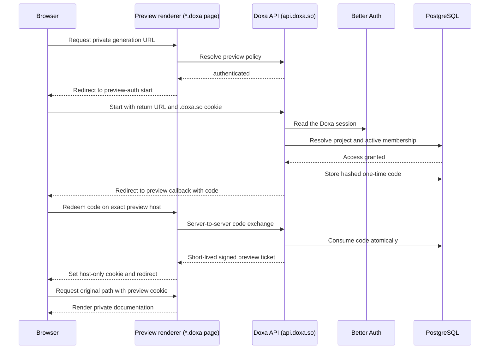

# Private Generation Preview Access

**Status:** Deferred implementation record  
**Last reviewed:** 2026-08-29  
**Current production behavior:** All generation previews are public.

## Purpose

This document records the current preview-access foundation and the remaining work.
It prevents a future implementation from repeating the completed work or enabling an incomplete gate.

The final access model uses organizations and organization members. A later phase adds teams and project assignments.

## Required Product Behavior

Public previews are available without a Doxa account.

Private previews require an authenticated Doxa user. The user must have access to the organization that owns the project.

The first membership release grants every active organization member access to every project in that organization.

The later team release limits regular members to projects assigned to one of their teams. Organization administrators keep organization-wide access.

Production documentation remains public. This setting applies only to generation previews.

## Preview Types

The platform currently has two preview URL types.

| Type | Example | Current access |
| --- | --- | --- |
| Permanent generation URL | `flagforge--a1b2c3d4e5f6.doxa.page` | Public |
| Pull-request channel | `flagforge-pr-42.doxa.page` | Public |

The production URL, such as `flagforge.doxa.page`, does not use preview access control.
Custom production domains do not use preview access control either.

## Implemented Foundation

### Visibility data and contracts

The database defines `docs_preview_visibility` with `private` and `public` values.
Each `docs_sites` row stores one `preview_visibility` value.

The first migration used `private` as the default. A follow-up migration changed all sites and the default to `public`.
This change prevents an unusable authentication loop while the cross-domain handoff is unavailable.

Relevant files:

- [`packages/db/src/schema/doxa.ts`](../../packages/db/src/schema/doxa.ts)
- [`packages/db/migrations/0018_charming_loki.sql`](../../packages/db/migrations/0018_charming_loki.sql)
- [`packages/db/migrations/0019_smooth_golden_guardian.sql`](../../packages/db/migrations/0019_smooth_golden_guardian.sql)
- [`packages/contracts/src/index.ts`](../../packages/contracts/src/index.ts)

### Owner-scoped setting API

The API can read and update the stored visibility value.
Both routes require the current project owner.

- `GET /projects/:projectId/preview-visibility`
- `PUT /projects/:projectId/preview-visibility`

The repository joins `projects.user_id` to the authenticated user. There is no organization or membership lookup yet.

Relevant files:

- [`apps/api/src/routes/projects.ts`](../../apps/api/src/routes/projects.ts)
- [`apps/api/src/repositories/preview-visibility.ts`](../../apps/api/src/repositories/preview-visibility.ts)
- [`apps/web/src/lib/dashboard/use-project-preview-visibility.ts`](../../apps/web/src/lib/dashboard/use-project-preview-visibility.ts)
- [`apps/web/src/lib/platform-api.ts`](../../apps/web/src/lib/platform-api.ts)

### Permanent generation host resolution

Permanent generation URLs use this format:

```text
{projectSlug}--{first12HexCharactersOfVersionId}.{DOCS_BASE_DOMAIN}
```

The API parses the hostname and resolves one immutable `docs_versions` row.
The resolution also reads `docs_sites.preview_visibility`.

An ambiguous version prefix returns no resolution. The API does not guess between matching versions.

Relevant files:

- [`apps/api/src/utils/docs-url.ts`](../../apps/api/src/utils/docs-url.ts)
- [`apps/api/src/repositories/docs.ts`](../../apps/api/src/repositories/docs.ts)
- [`apps/api/src/services/docs-host-resolution.ts`](../../apps/api/src/services/docs-host-resolution.ts)

### Access-policy endpoint

The renderer can request the policy for a permanent generation hostname:

```text
GET /internal/docs-access/:hostname
```

The endpoint returns `public` or `authenticated`. Unknown and invalid preview hosts return `authenticated`.
This behavior prevents hostname enumeration from opening an unknown preview.

The endpoint currently sends a 60-second public cache header.

Relevant files:

- [`apps/api/src/routes/internal.ts`](../../apps/api/src/routes/internal.ts)
- [`apps/api/src/services/docs-access.ts`](../../apps/api/src/services/docs-access.ts)

### Renderer gate

The renderer has a guard for permanent generation hostnames.
The guard runs before raw Markdown handling and normal page rendering.

The guard has these implemented behaviors:

- Production hostnames skip the policy request.
- Public generation previews render normally.
- Missing configuration returns `503`.
- Policy failures fail closed as `authenticated`.
- Unknown policy values fail closed as `authenticated`.
- Anonymous visitors receive a redirect to the Doxa login page.
- The policy response uses the Cloudflare Cache API.

The renderer contains a small hostname predicate because it cannot import platform internals.
The API parser and renderer predicate must remain equivalent.

Relevant files:

- [`apps/docs-template/src/server.ts`](../../apps/docs-template/src/server.ts)
- [`apps/docs-template/src/lib/access-gate.ts`](../../apps/docs-template/src/lib/access-gate.ts)
- [`apps/docs-template/src/lib/generation-preview-host.ts`](../../apps/docs-template/src/lib/generation-preview-host.ts)
- [`apps/docs-template/src/lib/access-gate.test.ts`](../../apps/docs-template/src/lib/access-gate.test.ts)
- [`apps/docs-template/src/lib/generation-preview-host.test.ts`](../../apps/docs-template/src/lib/generation-preview-host.test.ts)

### Safe rollout state

The API reads `DOCS_PREVIEW_GATE_ENABLED`. Only the exact value `true` enables private policy responses.

Production does not enable this value. The database reports all current sites as public.

The dashboard control is also disabled. Its text tells users that previews are public.

Relevant files:

- [`apps/api/src/env.ts`](../../apps/api/src/env.ts)
- [`apps/api/src/services/docs-access.ts`](../../apps/api/src/services/docs-access.ts)
- [`apps/web/src/components/dashboard/project-settings-page.tsx`](../../apps/web/src/components/dashboard/project-settings-page.tsx)

### Current test coverage

The current tests preserve the disabled but fail-closed foundation.

They cover these behaviors:

- Production documentation stays public.
- The feature flag accepts only the exact value `true`.
- A private setting returns public while the gate is off.
- A private setting requires authentication while the gate is on.
- Invalid and unknown hosts return an authenticated policy.
- The project setting routes require the current owner.
- The migrations leave all current sites public.
- The renderer gate runs only for permanent generation hostnames.
- Policy and session failures fail closed.
- Raw Markdown runs after the access gate.

Relevant files:

- [`apps/api/tests/services/docs-access.test.ts`](../../apps/api/tests/services/docs-access.test.ts)
- [`apps/api/tests/http/internal-docs.test.ts`](../../apps/api/tests/http/internal-docs.test.ts)
- [`apps/api/tests/http/projects.test.ts`](../../apps/api/tests/http/projects.test.ts)
- [`apps/docs-template/src/lib/access-gate.test.ts`](../../apps/docs-template/src/lib/access-gate.test.ts)
- [`apps/docs-template/src/lib/generation-preview-host.test.ts`](../../apps/docs-template/src/lib/generation-preview-host.test.ts)
- [`packages/db/tests/migration-ordering.test.mjs`](../../packages/db/tests/migration-ordering.test.mjs)

## Why Private Access Is Not Active

The Doxa dashboard session cookie uses the `.doxa.so` domain.
This cookie works on `doxa.so` and `api.doxa.so`.

A browser cannot send that cookie to `.doxa.page`. The two hosts do not share a registrable parent domain.

Cloudflare for SaaS routes requests and provides TLS. It does not change browser cookie-domain rules.

The current renderer gate forwards the request cookie to Better Auth.
A production request from `.doxa.page` does not contain the `.doxa.so` session cookie.

The current login page also ignores the renderer's `redirect` parameter. It always returns OAuth users to `/dashboard`.

Enabling the gate now creates an incomplete flow:

1. The private preview redirects the visitor to login.
2. Better Auth creates or reads the `.doxa.so` session.
3. The login page returns the visitor to the dashboard.
4. A new preview request still has no `.doxa.page` authorization cookie.

Relevant files:

- [`packages/auth/src/server.ts`](../../packages/auth/src/server.ts)
- [`apps/web/src/routes/login.tsx`](../../apps/web/src/routes/login.tsx)
- [`apps/web/src/lib/auth/use-auth-session.ts`](../../apps/web/src/lib/auth/use-auth-session.ts)
- [`apps/docs-template/src/lib/access-gate.ts`](../../apps/docs-template/src/lib/access-gate.ts)

## Current Authorization Limit

The dormant renderer gate checks only whether a Doxa user is signed in.
It does not check project ownership or membership.

The current data model gives each project one owner through `projects.user_id`.
It has no organization, organization member, team, or team member.

Private access must remain disabled until the authorization model and cross-domain handoff are complete.

## Target Organization Model

Implement organization membership before private previews become available.

### Minimum tables

#### `organizations`

Store the organization identity and display data.

Minimum fields:

- `id`
- `name`
- `slug`
- `created_at`
- `updated_at`

#### `organization_members`

Join a Doxa user to an organization.

Minimum fields:

- `id`
- `organization_id`
- `user_id`
- `role`
- `status`
- `created_at`
- `updated_at`

Use a unique constraint on `(organization_id, user_id)`.

The first roles can be `owner`, `admin`, and `member`.
The access path must accept only an active membership.

#### `projects.organization_id`

Every project must belong to one organization.

Keep `projects.user_id` during the migration period. Remove its ownership meaning only after all callers use organization authorization.

### Migration for existing projects

Use this order:

1. Create an organization for every existing project owner.
2. Create an owner membership for that user.
3. Attach the user's existing projects to that organization.
4. Update owner-scoped repositories to use organization authorization.
5. Make `projects.organization_id` required.
6. Remove or rename `projects.user_id` in a later migration.

Do not combine the final destructive step with the initial backfill.
The staged migration permits old and new API versions to overlap safely.

### First membership rule

An authenticated user can access a private preview when all conditions are true:

- The hostname resolves to one project.
- The project belongs to one organization.
- The user has an active membership in that organization.
- The preview is active and still resolves to the requested version.

This first rule gives every active organization member access to all organization projects.

## Later Team Model

Add teams after the organization membership release is stable.

### Future tables

#### `teams`

Each team belongs to one organization.

Minimum fields:

- `id`
- `organization_id`
- `name`
- `slug`
- `created_at`
- `updated_at`

#### `team_members`

Join an organization member to a team.
Reference `organization_members.id`, not `user.id` directly.

Use a unique constraint on `(team_id, organization_member_id)`.

#### `project_teams`

Grant one team access to one project.

Use a unique constraint on `(project_id, team_id)`.
The API must make sure that the project and team belong to the same organization.

### Team access rule

Organization owners and administrators can access every project in the organization.

A regular member can access a private preview when one of the member's teams has access to the project.

The access check must start from the resolved project. It must never trust a project ID from the browser.

## Required Cross-Domain Authentication Handoff

Use a short-lived, one-time code to move authorization from `.doxa.so` to one `.doxa.page` host.



### Start route

The start route runs under `.doxa.so`, where the Better Auth cookie is available.

The route must:

- Parse and allowlist the return URL.
- Accept only configured `.doxa.page` preview hostnames.
- Resolve the hostname through the platform mapping.
- Read the Better Auth session.
- Check organization or team access for the resolved project.
- Create a random, single-use code.
- Redirect to a fixed callback path on the exact preview hostname.

An unauthenticated visitor can go through the normal login flow.
The login state must preserve the validated preview return URL.

### One-time code storage

Use PostgreSQL for the first implementation. An atomic update can prevent two redemptions.

A future `docs_preview_auth_codes` table needs these values:

- A hash of the random code
- The authenticated user ID
- The resolved project ID
- The exact preview hostname
- The validated return path
- The expiration time
- The consumption time
- The creation time

Do not store the raw code. Do not log the raw code.

The code must expire after a short period, such as 60 to 120 seconds.
The redemption operation must change an unused code to used in one atomic transaction.

### Preview callback

The renderer must handle a reserved callback path before Markdown or page rendering.

The callback must:

- Send the code to the API through a server-to-server request.
- Include the current request hostname in the redemption request.
- Reject a ticket for another hostname or project.
- Set a host-only preview cookie.
- Redirect to the stored return path without the code.

Use a cookie with these properties:

```text
__Host-doxa_preview=<signed-ticket>; Secure; HttpOnly; SameSite=Lax; Path=/
```

Do not add a `Domain` attribute. The `__Host-` prefix requires a host-only cookie.

### Preview ticket

The ticket must contain or bind these values:

- User ID
- Organization ID
- Project ID
- Exact preview hostname
- Issued time
- Expiration time
- Unique token ID

The API signs the ticket. The renderer verifies it without a browser-visible secret.

Use a dedicated signing key. Do not reuse the Better Auth secret or the docs-content token.

Keep the ticket lifetime short. A short lifetime limits access after a member loses access.

## Authorization Service Boundary

Put membership decisions in one API service. Routes and repositories must not duplicate role logic.

The service can expose a typed operation similar to:

```ts
authorizeProjectAccess({ userId, projectId }): Promise<ProjectAccessDecision>
```

The decision must include a stable denial reason. Useful reasons include:

- `not_authenticated`
- `organization_membership_required`
- `organization_membership_inactive`
- `project_team_access_required`
- `preview_not_found`
- `preview_expired`

Do not send detailed membership information to an anonymous user.
Use the same public response for an unknown private hostname and an unauthorized private hostname.

## Pull-Request Preview Coverage

The current gate recognizes only permanent `slug--version` hostnames.

Pull-request channels use `slug-pr-number` hostnames. Their resolver currently forces a public policy.

The future gate must protect both hostname types:

- Permanent generation URLs
- Active pull-request preview channels

Use one shared preview-host classification contract inside the API.
Keep the renderer's pure hostname predicate synchronized through shared test cases.

Production and custom domains must continue to bypass this gate.

## Policy Cache Requirements

The current renderer caches a policy for 60 seconds.

A stale private policy blocks access for a short period. This result is safe but inconvenient.

A stale public policy can expose a preview after an owner changes it to private. This result is not acceptable.

Before the dashboard control becomes active, implement global invalidation for a public-to-private change.

The update operation must invalidate every policy cache entry for the site's permanent and pull-request preview hostnames.

If global invalidation is not ready, do not cache public policy responses.
Correct access control has priority over the render-path optimization.

## Membership and Session Revocation

A signed preview ticket can remain valid after membership changes.

The first release can use a short ticket lifetime and require a new handoff after expiration.
Document the selected maximum delay before production enablement.

If immediate member revocation becomes a requirement, add an authorization version or a server-side session lookup.
Do not silently claim immediate revocation while a valid local ticket can still render content.

## Dashboard Work

After the backend flow is complete, restore the existing visibility hook in project settings.

The control must:

- Show the stored `public` or `private` value.
- Describe organization access for private previews.
- Require confirmation before a public-to-private or private-to-public change.
- Show an error when cache invalidation fails.
- Update the cached dashboard query after success.

Do not enable the control before the authentication handoff and cache invalidation work.

## Rollout Plan

### Phase 1: Organizations and members

- Add organization and organization-member contracts.
- Add staged database migrations and owner backfills.
- Move project authorization into one service.
- Keep every preview public.

### Phase 2: Authentication handoff

- Add the preview-auth start route.
- Preserve the validated preview URL through OAuth login.
- Add one-time code storage and atomic redemption.
- Add the renderer callback and host-only cookie.
- Add signed preview-ticket verification.
- Keep `DOCS_PREVIEW_GATE_ENABLED` off.

### Phase 3: Preview coverage and cache safety

- Protect permanent generation URLs.
- Protect pull-request preview channels.
- Add public-to-private cache invalidation.
- Add access decisions and safe audit events.

### Phase 4: Controlled enablement

- Change the default for new sites to `private`.
- Keep existing sites public until owners select private.
- Re-enable the dashboard control.
- Enable the gate in a test environment.
- Complete browser tests on `.localhost` and `.doxa.page`.
- Enable the production gate after the tests pass.

### Phase 5: Teams

- Add teams and team memberships.
- Add project-to-team access grants.
- Update the authorization service.
- Add team management to the dashboard.

## Required Tests

### Membership tests

- An active organization member can access an organization project.
- A user outside the organization cannot access the project.
- An invited, suspended, or removed member cannot access the project.
- An organization administrator can access every organization project.
- A regular team member can access only assigned projects after team scoping is active.

### Authentication handoff tests

- An anonymous visitor returns to the original preview after login.
- An existing signed-in user skips the provider login page.
- A code works only once.
- An expired code fails.
- A code for one hostname fails on another hostname.
- An external return URL fails validation.
- The callback does not place the code in the final URL.
- The cookie has `Secure`, `HttpOnly`, `SameSite=Lax`, and `Path=/`.
- The cookie has no `Domain` attribute.

### Gate tests

- Public previews render without a session.
- Private permanent previews require authorized membership.
- Private pull-request previews require authorized membership.
- Production and custom domains remain public.
- Raw Markdown cannot bypass the gate.
- Policy, session, and membership failures fail closed.
- Unknown preview hostnames do not reveal whether a project exists.

### Cache tests

- A public-to-private update removes every affected public policy entry.
- A failed invalidation leaves the dashboard setting unchanged or reports a recoverable failure.
- A private-to-public update does not leave a permanent authentication redirect.

### Browser tests

- Complete the flow with local `.localhost` preview hostnames.
- Complete the flow with production-shaped `.doxa.page` hostnames in a test environment.
- Open two private project previews and make sure that each host receives only its own cookie.
- Remove a member and measure the documented revocation delay.

## Observability and Audit Rules

Record these events without secrets:

- Preview-auth start
- Login required
- Membership granted or denied
- One-time code issued
- Code redeemed
- Code rejected by reason
- Preview ticket expired
- Visibility changed
- Policy cache invalidated

Do not log OAuth codes, preview codes, session cookies, signed tickets, or complete query strings.

Include the organization ID, project ID, preview type, and hostname when they are safe and available.

## Decisions Preserved by This Document

- Private access is organization-based, not owner-only.
- The first membership release gives active organization members access to all organization projects.
- Teams arrive later and limit regular members to assigned projects.
- A project always belongs to one organization.
- The API resolves the project from the hostname before it checks access.
- `.doxa.so` and `.doxa.page` use a one-time authorization handoff.
- Each preview hostname receives a host-only cookie.
- Production documentation remains public.
- Both permanent generation URLs and pull-request channels need protection.
- The gate remains disabled until membership, handoff, and cache safety are complete.

## Resume Checklist

Before implementation starts, read these files:

- [`apps/api/src/services/docs-access.ts`](../../apps/api/src/services/docs-access.ts)
- [`apps/api/src/services/docs-host-resolution.ts`](../../apps/api/src/services/docs-host-resolution.ts)
- [`apps/api/src/repositories/docs.ts`](../../apps/api/src/repositories/docs.ts)
- [`apps/api/src/repositories/preview-channels.ts`](../../apps/api/src/repositories/preview-channels.ts)
- [`apps/api/src/repositories/preview-visibility.ts`](../../apps/api/src/repositories/preview-visibility.ts)
- [`apps/api/src/routes/internal.ts`](../../apps/api/src/routes/internal.ts)
- [`apps/docs-template/src/lib/access-gate.ts`](../../apps/docs-template/src/lib/access-gate.ts)
- [`apps/docs-template/src/lib/generation-preview-host.ts`](../../apps/docs-template/src/lib/generation-preview-host.ts)
- [`apps/docs-template/src/server.ts`](../../apps/docs-template/src/server.ts)
- [`apps/web/src/routes/login.tsx`](../../apps/web/src/routes/login.tsx)
- [`apps/web/src/lib/auth/use-auth-session.ts`](../../apps/web/src/lib/auth/use-auth-session.ts)
- [`apps/web/src/components/dashboard/project-settings-page.tsx`](../../apps/web/src/components/dashboard/project-settings-page.tsx)
- [`packages/db/src/schema/doxa.ts`](../../packages/db/src/schema/doxa.ts)

Then make sure that these production facts are still true:

- `DOCS_PREVIEW_GATE_ENABLED` is not active.
- Existing sites still report public visibility.
- The dashboard visibility control is disabled.
- The auth cookie remains scoped to `.doxa.so`.
- The renderer route still runs the access gate before raw Markdown.

If any fact changed, update this document before implementation continues.
