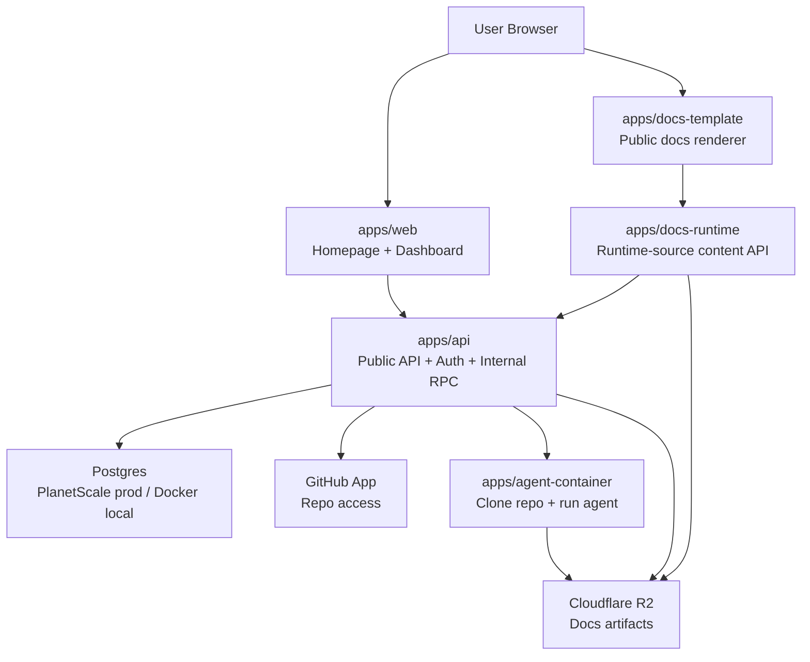
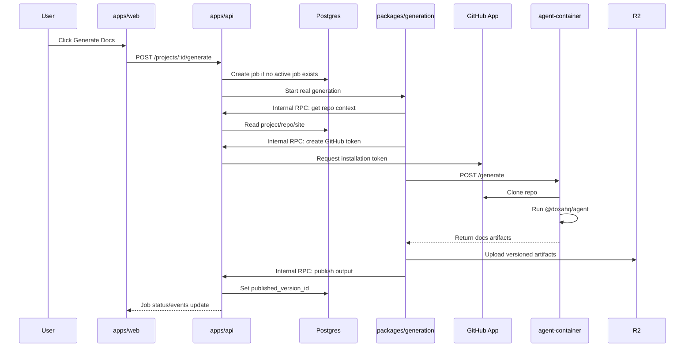
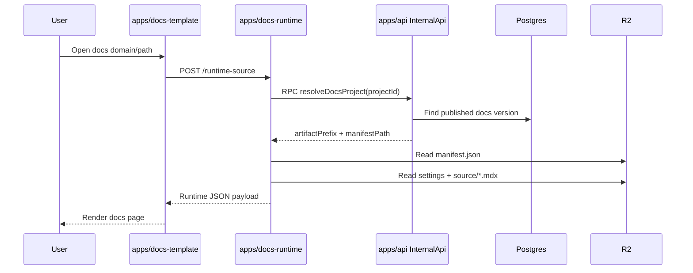
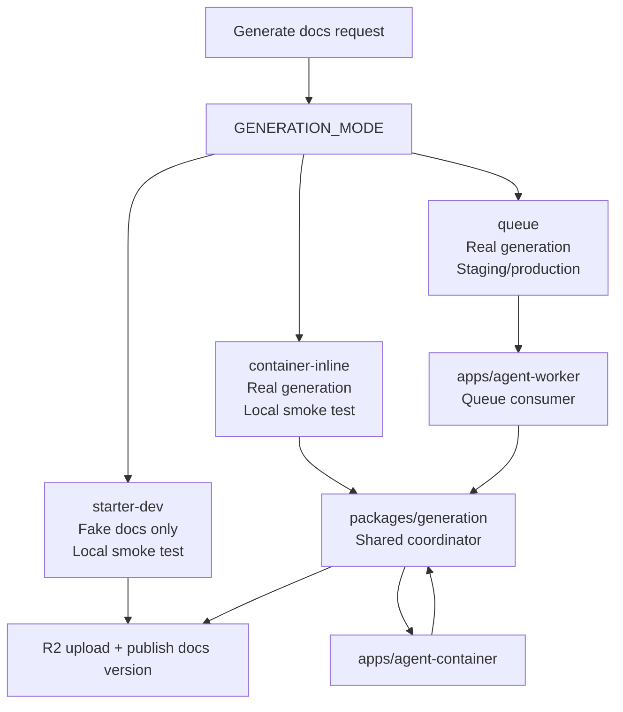

# Doxa Platform Diagrams

These diagrams document the current MVP architecture for `doxa-platform`.

## Current Generation Pipeline

The source-linked end-to-end diagram covers manual production admission,
Doxabot previews, Cloudflare Queue and Workflow orchestration, stage-isolated
agent containers, incremental reuse, page replay checkpoints, publication,
observability, cancellation, and runtime delivery.

Source: [`generation-pipeline-v1.mmd`](./generation-pipeline-v1.mmd)

## Proposed Graph-Enabled Generation Pipeline

The proposed end-to-end integration of a versioned semantic dependency graph
into the revision-aware generation workflow. It covers graph loading and
validation, public-surface extraction, impact traversal, guide and reference
dependencies, safe fallback, graph finalization, immutable R2 persistence, and
the shadow-mode observability needed before graph decisions can skip work.

Nodes prefixed with `NEW` are proposed additions; the remaining nodes describe
the current pipeline behavior.

Source: [`generation-pipeline-with-dependency-graph.mmd`](./generation-pipeline-with-dependency-graph.mmd)

## Docs Preview Update Pipeline

A narrower, deeper walkthrough of the incremental PR-preview path: GitHub
webhook admission, baseline selection, content-addressed source diffing, the
revision-aware decision ladder, per-page dependency reuse, and selective page
writing. Includes a measured timing breakdown, current bottlenecks, and ranked
improvement levers.

Read this one when working on generation speed or reuse rates.

Source: [`docs-preview-update-pipeline.md`](./docs-preview-update-pipeline.md)
· [`docs-preview-update-pipeline.mmd`](./docs-preview-update-pipeline.mmd)

## High-Level System

Source: [`high-level-system.mmd`](./high-level-system.mmd)

## Dashboard Generate Flow

Source: [`dashboard-generate-flow.mmd`](./dashboard-generate-flow.mmd)

## Docs Viewing Flow

Source: [`docs-viewing-flow.mmd`](./docs-viewing-flow.mmd)

## Generation Modes

Source: [`generation-modes.mmd`](./generation-modes.mmd)

## Current Mental Model

- `apps/api` is the control plane.
- `packages/generation` is the shared orchestration layer.
- `apps/agent-container` does the heavy repository checkout and agent execution work.
- `apps/docs-template` is the shared user-facing docs renderer.
- `apps/docs-runtime` is the runtime-source content API for the shared template and serves only the currently published R2 artifacts.
- The `apps/docs-runtime` `/:projectSlug` HTML route is a legacy local preview/debug surface, not the target production renderer.
- `/internal/*` HTTP routes are dev-only fallback; staging and production should use `InternalApi` service-binding RPC.
