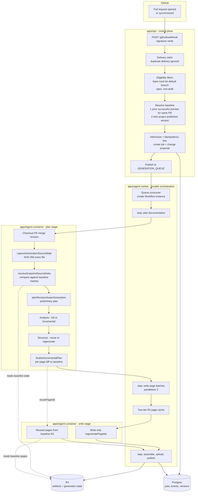
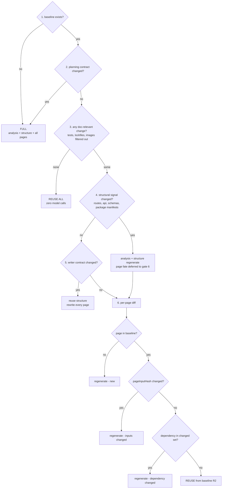

# Docs Preview Update Pipeline

How a GitHub pull request becomes a documentation preview, with emphasis on the
diffing and reuse decisions that determine how much work the run actually does.

`generation-pipeline-v1.mmd` covers all generation modes end to end. This
document is narrower and deeper: it follows only the incremental PR-preview
path and explains every point where the pipeline decides to reuse or redo work.

Measurements throughout come from generation `875ae22b` (FlagForge PR #4,
2026-07-31, 9m 56s, 4 pages reused, 26 regenerated) unless stated otherwise.

Source: [`docs-preview-update-pipeline.mmd`](./docs-preview-update-pipeline.mmd)

---

## 1. End-to-end flow



---

## 2. Admission — `apps/api`

The webhook is verified, claimed for de-duplication, then filtered. A delivery
is ignored when the PR targets a non-default base branch, is closed, is a draft,
or the project is disabled. Surviving deliveries get an idempotency key so a
redelivered webhook replays rather than double-generates.

**The baseline choice matters more than it looks.**
`findSuccessfulCompatiblePreview` (`webhook-orchestrator.ts`) looks for a prior
successful preview of the *same* PR, keyed on `changeExternalId`. Only if none
exists does it fall back to the project's published version.

| scenario | baseline | expected diff |
|---|---|---|
| first push to a new PR | project published version | everything since main |
| second push to the same PR | previous preview of that PR | only the newest commits |

Every measured run so far was a first push to a fresh PR, so all of them diffed
against the published baseline. **Repeat pushes to one PR should reuse far more
and have never been measured.** That is the cheapest available experiment.

---

## 3. Source diffing — `apps/agent-container`

No git diff is involved. The container checks out the PR *merge* revision, then:

1. `captureGenerationSourceState` walks the tree and records
   `{path, contentHash (SHA-256), contentKind}` for every file.
2. `resolveSnapshotSourceDelta` compares that set against the baseline's stored
   source state, producing added / modified / deleted / renamed changes.
   Renames are detected by identical `contentKind:contentHash` appearing once on
   each side.

Because it is content-addressed, this works across arbitrary revision pairs and
is unaffected by rebases or force pushes. In run `875ae22b` it reported
`sourceChangeCount=4`, matching the PR's four changed files exactly.

The persisted baseline state (`sites/{siteId}/generation-state/{versionId}/`)
holds four parts: source hashes, the analysis plus `analysisHash`, the structure
plus `structuralFingerprint`, and per-page records carrying `pageInputHash`,
`contentHash`, and a **dependency ledger**.

The dependency ledger is the heart of reuse. While each page is written, tool
calls are tracked, and on completion the page records the files it actually read,
globbed, or pinned as evidence (`generation-service.ts`, via
`createPageDependencyState`). That list is what later gets intersected against
the changed-file set.

---

## 4. The decision ladder — `planRevisionAwareGeneration`

Gates evaluate in order; the first match wins and the rest never run.



Gate 6 runs **twice**: once as a preliminary plan against the previous
structure (to decide analysis and structure mode), and again in
`finalizeIncrementalPlan` after the new structure exists. The second pass is the
one that decides page fate. Before that split existed, a structural change
forced every page to regenerate regardless of dependencies.

`pageInputHash` covers a page's identity and brief — id, title, section title,
output path, description, source evidence, parent, collection linkage, and
reference. Any drift in those fields makes an otherwise-untouched page look
changed.

---

## 5. Where the time goes

Run `875ae22b`, 30-page structure:

| phase | duration | share |
|---|---|---|
| queue → container boot | 3s | <1% |
| checkout + source hashing + delta | 3s | <1% |
| **analysis (full)** | **3m 36s** | **36%** |
| structure generation | 1m 11s | 12% |
| structure review | 23s | 4% |
| write 26 pages (batches of 6, parallelism 2) | 4m 38s | 47% |
| assemble + publish | ~1s | <1% |
| **total** | **9m 56s** | |

Planning is 53% of the run and writing is 47%. Both are model-bound; the
deterministic parts (checkout, hashing, diffing, publishing) cost about 7
seconds combined.

Trend across measured runs:

| run | date | total | reused | regenerated |
|---|---|---|---|---|
| `699ba88a` | Jul 30 | 11m 35s | 0 | 36 |
| `1d217740` | Jul 31 | failed | — | — |
| `875ae22b` | Jul 31 | 9m 56s | 4 | 26 |

---

## 6. Current bottlenecks

### 6.1 Gate 4 forces a full analysis

A structural change sets `analysisMode: "full"` *and*
`structureMode: "regenerate"`. The full analysis discards a perfectly valid
prior analysis and costs ~3m 36s. Worse, a fresh analysis detects surfaces
slightly differently, which produces a different structure, which changes page
IDs — so pages that were not touched look brand new to gate 6 and regenerate.

This is the dominant reason only 4 of 30 pages were reused. The structure anchor
(the published structure fed into the regeneration prompt) can hold page
identity steady only when the analysis it derives from is stable.

Note that `analysisMode: "incremental"` is currently unreachable in the hosted
pipeline: the incremental branch requires a documentation-brief fingerprint that
never round-trips into persisted generation state, so the guard always falls
through to a full analysis.

### 6.2 `isStructuralSourcePath` is broad

```
/(?:^|\/)(?:routes?|api|schemas?|openapi|swagger|graphql)(?:\/|\.|-)/
```

Any file under an `api/`, `routes/`, or `schemas/` directory is structural. In a
monorepo that is most backend code — three of PR #4's four files matched.
Narrowing it is tempting but trades correctness for speed: structure
regeneration is what creates a page for a newly added endpoint, which is exactly
what PR #4 added.

### 6.3 Regeneration causes are not reported

Only `reasons[0]` reaches the job event stream, so "regenerated because a
dependency changed" cannot be distinguished from "regenerated because the page
is new". That is precisely the number worth optimizing, and it is currently
invisible.

### 6.4 Page cache keys are repo-global

The two-tier R2 page cache keys on `structuralFingerprint` and `analysisHash`
alongside the per-page `dependencyDigest`. Both global fields change whenever
anything structural moves, so every key misses in exactly the situation the
cache exists for. Cross-model reuse is additionally off in production
(`DOXA_PAGE_CACHE_CROSS_MODEL` unset).

### 6.5 Write stage parallelism

Batches of 6 pages, 2 batches concurrently (`DOXA_WRITE_BATCH_PARALLELISM`,
capped at 4). 26 pages took 4m 38s. Raising parallelism trades against container
CPU and OpenRouter rate limits; the container currently runs `standard-3`
(2 vCPU, 8 GiB).

---

## 7. Improvement levers, ranked

| # | change | expected effect | risk |
|---|---|---|---|
| 1 | Make gate 4 reuse the analysis (`incremental`), and fix the brief-fingerprint round-trip so that mode is reachable | removes ~3m; stabilizes structure so the anchor holds and reuse rises | low — structure still regenerates, so new surfaces still get pages |
| 2 | Report regeneration cause counts on the `structure_created` event | makes reuse measurable | none |
| 3 | Test a second push to an existing PR | exercises the preview-to-preview baseline, never yet measured | none, costs one run |
| 4 | Drop `structuralFingerprint` and `analysisHash` from the page cache key | cache can hit when structure moves | medium — needs care that per-page keys stay correct |
| 5 | Raise `DOXA_WRITE_BATCH_PARALLELISM` to 3–4 | cuts write phase | rate limits, container CPU |
| 6 | Narrow `isStructuralSourcePath` | avoids structure regeneration entirely for handler edits | **correctness** — new endpoints may go undocumented until a production run |

Items 1–3 are complementary and carry little risk. Item 6 should only be
revisited after item 2 shows that structure regeneration is still the binding
constraint.

---

## 8. Known quality issues

- A published preview emitted `Generated page /introduction links to a route
  absent from final navigation: /api-reference/sdk-client` — a dead link caused
  by structure/navigation drift.
- `applyGenerationProfileBudget` trims pages to the editorial budget *after*
  review with no re-validation, so it can silently break collection coverage.
- Structure review remains terminal after three attempts. Provably infeasible
  cases (mandatory collection page floor above the ceiling) and pipeline defects
  now fail fast, but a proposal much larger than the ceiling can still exhaust
  all three attempts.
